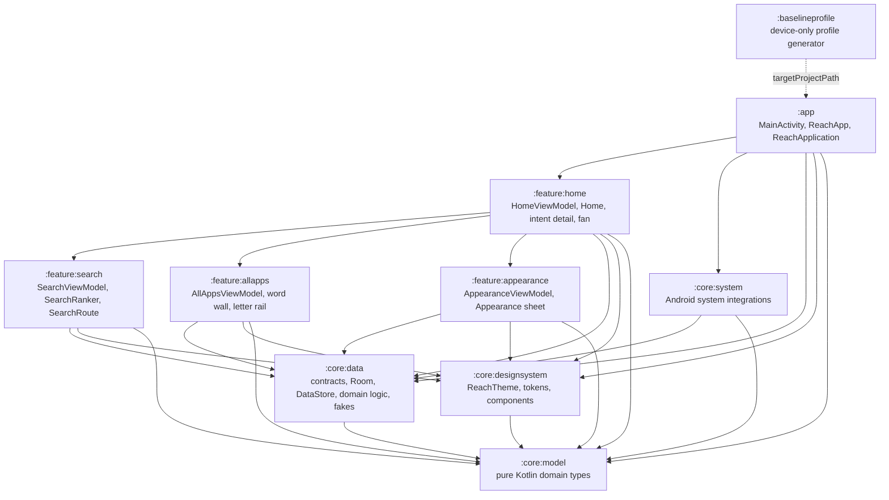
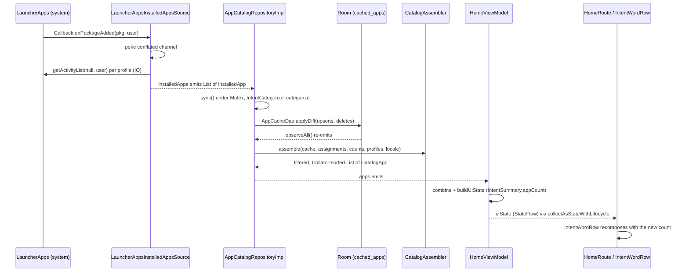
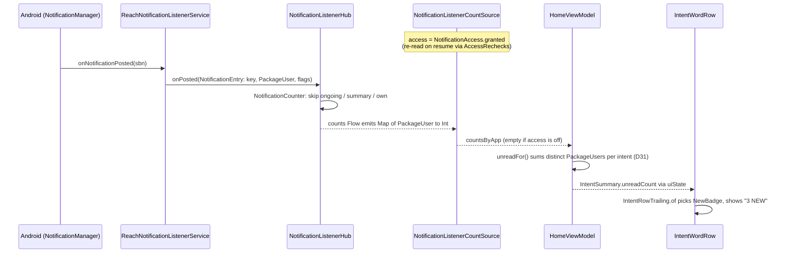
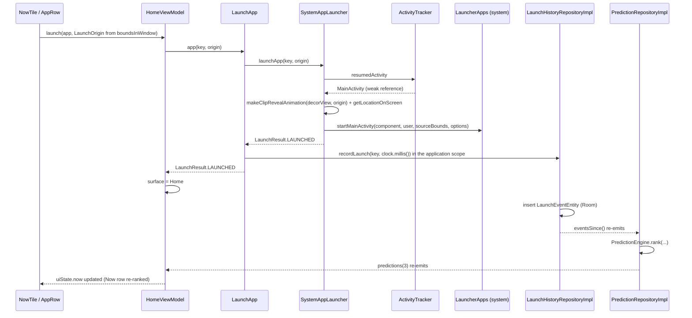
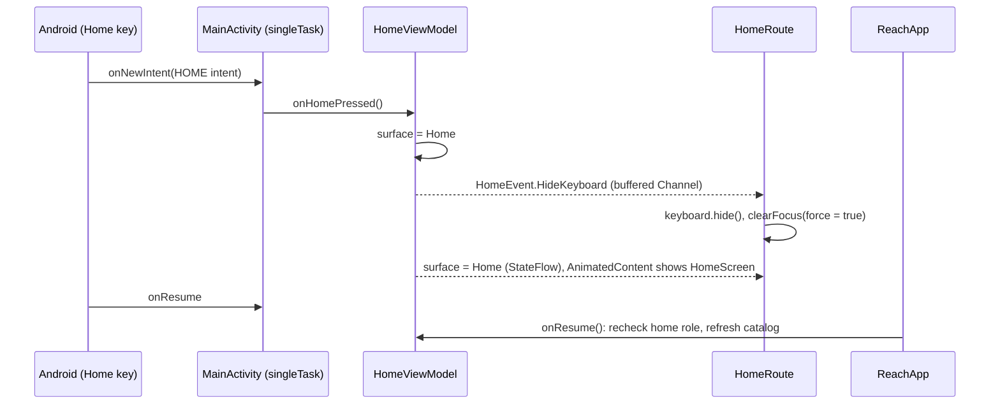
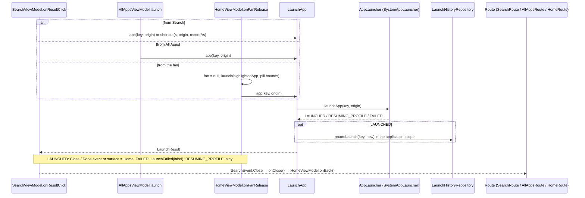
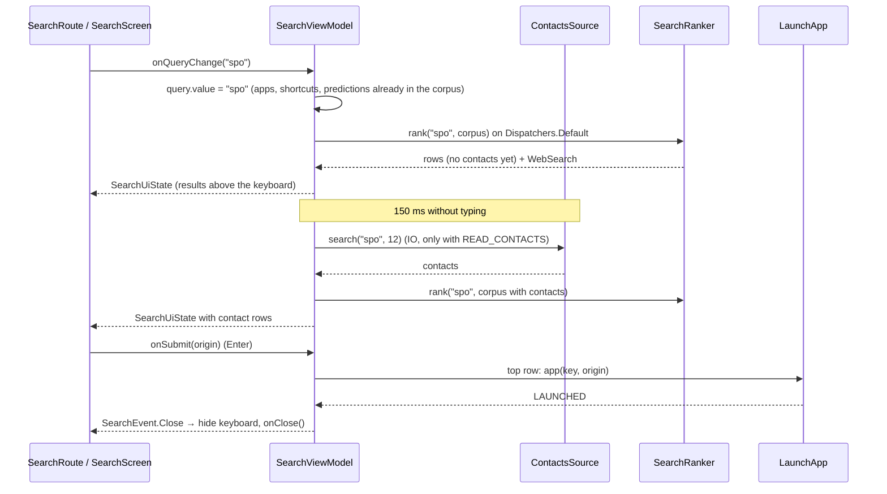
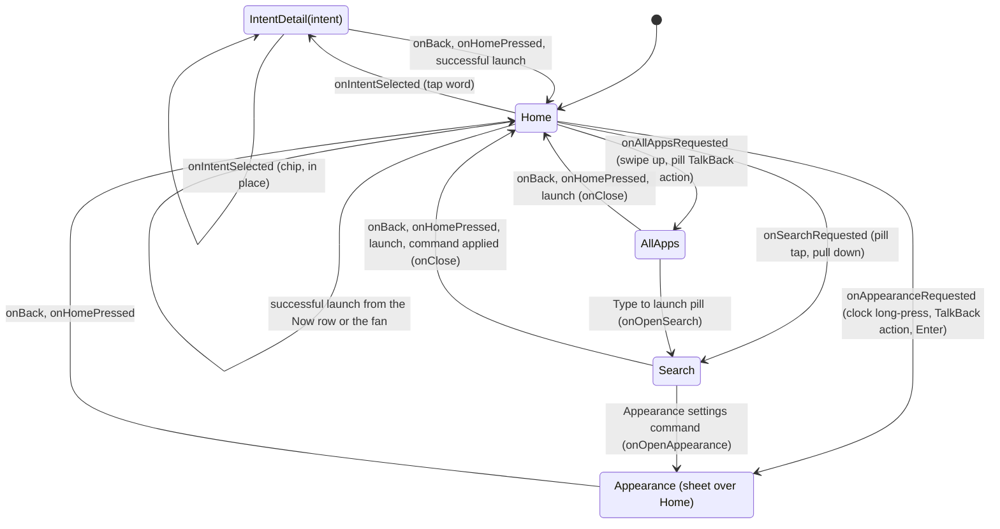

# Reach — architecture

**v5 (M5).** Describes the code as it is at the end of milestone M5 ("Polish": the optional
accessibility service behind a `ScreenActionsHub`, private space, the `:baselineprofile` module,
whole-app R8). No `Unavailable…` stub is left: every system source has a real implementation. The product spec is [`reach-launcher-prompt.md`](reach-launcher-prompt.md); the
reasons behind the choices are in [`DECISIONS.md`](DECISIONS.md) (D1–D73); the Flutter →
Compose vocabulary is in [`FLUTTER_TO_COMPOSE.md`](FLUTTER_TO_COMPOSE.md); custom touch
handling is explained in [`GESTURES.md`](GESTURES.md).

Paths below are abbreviated: `…` = the `src/main/kotlin/com/baklavapp/reachlauncher/<module>`
part, e.g. `core/data/…/db/` = `core/data/src/main/kotlin/com/baklavapp/reachlauncher/core/data/db/`.

---

## 1. Modules



The edges are exactly the `project(":…")` dependencies in each module's `build.gradle.kts`.
`:core:data` and `:core:designsystem` re-export `:core:model` with `api(…)`, so the direct
`--> model` edges from features are technically redundant but are declared anyway for
readability.

| Module | Kind | What lives there (M2) |
|---|---|---|
| `:app` | Android application | `MainActivity` (HOME activity; reads the settings snapshot before the first frame, D63), `ReachWindow.kt` (`WindowAppearance` + `ReachWindow`: wallpaper flag, window background, blur, D62), `ReachApp` (root composable), `ReachApplication` (`@HiltAndroidApp`), the manifest, window theme, backup rules |
| `:core:model` | **pure Kotlin/JVM** (no Android) | `AppKey`, `PackageUser`, `CatalogApp`, `InstalledApp`, `ProfileState`, `ReachIntent`, `LaunchEvent`, `Prediction`, `AppearanceSettings`, `LaunchOrigin`, `SystemScreen`, `ExternalAction`, `TextFolding`… |
| `:core:designsystem` | Android library + Compose | `ReachTheme`, palettes, `PaletteNames.kt` (localised palette names, shared by Search's commands and the Appearance sheet), derived tokens, `ColorMath`, typography + fonts, `ReachColors.wallpaperMode` with the derived `root` / `backdrop` tokens, `resolveDark()`, components (`AppActionsMenu` — the long-press menu shared by All Apps and intent detail, D64 —, `IntentWordRow`, `NowTile`, `AppRow`, `SearchPill`, `Monogram`, `reachClickable`…), `util/Motion.kt` (`rememberReducedMotion`, `rememberHapticTick`) |
| `:core:data` | Android library | **Contracts** (`repository/Repositories.kt`, `source/SystemSources.kt`), their **implementations** for data (`repository/impl`, `db`, `domain` — incl. the shared `LaunchApp` use case —, `time`), Hilt modules (`di`), and **fakes** (`fake`, in `src/main` — D4) |
| `:core:system` | Android library | Implementations of the system-source contracts (`LauncherAppsInstalledAppsSource`, `UserManagerProfileSource`, `SystemAppLauncher`, `TelephonyDefaultAppsSource`, `RoleHomeRoleSource`, **`LauncherAppsShortcutSource`** and **`ContactsProviderSource`** (M2), **M3:** `ReachNotificationListenerService` + `NotificationListenerHub` / `NotificationListenerCountSource` / `NotificationAccess`, `MediaSessionsSource`, `CalendarProviderSource`, `UsageStatsManagerSource`, `AccessRechecks`; **M5:** `screen/` — `ReachAccessibilityService` (the system-created service), `ScreenActionsHub` (singleton the service registers a lock/shade performer in) and `AccessibilityScreenActionsSource` (the real `ScreenActionsSource`; D66)), `ActivityTracker`, `SystemModule` |
| `:baselineprofile` | Android test module (`com.android.test`) | `BaselineProfileGenerator`: UiAutomator drives the installed release `:app` (cold start, intent detail, Search, All Apps) to record a Baseline Profile (D68). Not part of `build`; needs a device |
| `:feature:home` | Android library + Compose | `HomeViewModel` (the surface state machine + the fan's state), `HomeRoute` (hosts Search / All Apps as slots, D51), Home and intent-detail screens, `ui/SystemCards.kt` (Now Playing card, calendar line, onboarding cards), `MediaProgress.kt`, press-slide-release (`ui/PressSlideRelease.kt`, `ui/FanOverlay.kt`, `ui/HomeWithFan.kt`), Home swipes (`ui/HomeGestures.kt`), the Appearance placeholder sheet (`ui/PlaceholderSurfaces.kt`, until M4) |
| `:feature:search` | Android library + Compose | `SearchRoute` (public), `SearchViewModel`, `SearchRanker` + `CommandKeywords` (pure), `SearchResult` / `SearchUiState`, `ui/SearchScreen.kt` |
| `:feature:allapps` | Android library + Compose | `AllAppsRoute` (public), `AllAppsViewModel`, `LetterIndex` (ICU), `ui/AllAppsScreen.kt` (word wall), `ui/LetterRail.kt`, long-press menu from `:core:designsystem` (D64) |
| `:feature:appearance` | Android library + Compose | `AppearanceRoute(onClose)` (public), `AppearanceViewModel` (no draft: every control calls a `SettingsRepository` setter), `ui/AppearanceSheet.kt` (theme Auto/Dark/Light, 7 palette swatches, Show wallpaper switch, thumb side) — D60 |

### Dependency rules and why

1. **Features never import `:core:system`.** Look at `feature/*/build.gradle.kts`: none
   of them lists it. A feature can only reach Android through the interfaces in
   `:core:data/…/source/SystemSources.kt` (D3). Consequences:
   - `HomeViewModelTest` is a plain JVM test with fakes (`HomeTestFixtures.kt` builds the
     ViewModel from `FakeAppCatalogRepository`, `FakeAppLauncher`, …).
   - Every system integration is optional: as of M5 there are no stubs left, and every
     access-gated source degrades to "none" without its permission (or, for screen actions,
     without the accessibility service) — Home and Search work anyway.
2. **Contracts live in `:core:data`, not in `:core:system`.** `:core:system` depends on
   `:core:data` to implement them (dependency inversion). Flutter analogy: the
   `*_platform_interface` package of a federated plugin.
3. **No Android types in contracts** (D11). They use domain types such as `LaunchOrigin`
   (four ints), `SystemScreen` (an enum) and `ExternalAction` (a sealed interface) instead
   of `Intent`, `View` or `Rect`. On the plain JVM, `android.content.Intent` can't even be
   constructed, so an `Intent` in a contract would push every ViewModel test onto
   Robolectric.
4. **`:app` is the only module that sees both sides** and therefore the only place where
   Hilt can assemble the whole graph. The `@Module`s themselves sit next to the code they
   bind (`core/data/…/di/DataModules.kt`, `core/system/…/di/SystemModule.kt`); Hilt
   collects every `@InstallIn(SingletonComponent::class)` module on the classpath of
   `:app` at compile time.
5. **`:core:model` has no Android dependency** (`kotlin.jvm` plugin), so its tests are
   fast JVM tests and it can never leak a platform type.
6. **Feature modules don't depend on each other**, except that `:feature:home` hosts the
   others: Search, All Apps and Appearance are *states* of the Home surface (§4), not
   separate screens. The dependency is one-way and narrow: Home only calls the public
   `SearchRoute(onClose, onOpenAppearance)` and `AllAppsRoute(onClose, onOpenSearch)`;
   neither module ever sees `HomeViewModel` (D51, §4a).
7. **One launch path.** Every screen launches through the `LaunchApp` use case in
   `:core:data` (§3e), so history is recorded the same way everywhere.

---

## 2. Layers

Every data path in Reach has the same shape. Here it is next to the Flutter
clean-architecture layers you know:

| Reach layer | Example (M2) | Flutter clean architecture |
|---|---|---|
| Stateless composables | `HomeScreen`, `IntentDetailScreen`, `SearchScreen`, `AllAppsScreen`, `LetterRail`, `IntentWordRow`, `NowTile` | widgets (`StatelessWidget` taking state + callbacks) |
| Route (state ↔ UI glue) | `HomeRoute` (collects state, handles events and Back), `SearchRoute`, `AllAppsRoute` | `BlocBuilder` / `BlocListener` / `PopScope` around a page |
| ViewModel | `HomeViewModel`, `SearchViewModel`, `AllAppsViewModel` — `StateFlow<…UiState>`, `Flow<…Event>` | BLoC / Cubit |
| Use case | `LaunchApp` (`core/data/…/domain/LaunchApp.kt`) | a use-case class with `call()` shared by several BLoCs |
| Repository interface | `AppCatalogRepository`, `LaunchHistoryRepository`, `PredictionRepository`, `SettingsRepository` (`core/data/…/repository/Repositories.kt`) | `domain/repositories` abstract classes |
| System-source interface | `InstalledAppsSource`, `ProfileSource`, `AppLauncher`, `NotificationCountSource`… (`core/data/…/source/SystemSources.kt`) | plugin platform interface / abstract data source |
| Pure domain logic | `CatalogAssembler`, `IntentCategorizer`, `PredictionEngine`, `hourTicks` (`core/data/…/domain`, `…/time`); `SearchRanker` (`feature/search/…`), `LetterIndex` / `buildUiState` (`feature/allapps/…`) | pure Dart services |
| Repository implementation | `AppCatalogRepositoryImpl`, `LaunchHistoryRepositoryImpl`, `PredictionRepositoryImpl`, `SettingsRepositoryImpl` | `data/repositories` implementations |
| Data sources | Room (`ReachDatabase`, DAOs), DataStore (`DataStore<Preferences>`), system sources in `:core:system` | drift/sqflite, shared_preferences, platform plugins |

Two things differ from a typical Flutter app:

- **Streams all the way down.** Room DAOs return `Flow`s that re-emit when a table changes
  (≈ drift `watch()`), DataStore's `data` is a `Flow`, system callbacks are wrapped in
  `callbackFlow`. Repositories combine those flows; the ViewModel `combine`s the
  repositories into one `HomeUiState`. Nobody "reloads" — new data simply flows through.
- **Two kinds of lifetime.** `viewModelScope` dies with the ViewModel (≈ `Bloc.close()`);
  `@ApplicationScope` (`CoroutinesModule.provideApplicationScope`, a `SupervisorJob` on
  `Dispatchers.Default`) lives as long as the process. Work that must continue while no
  screen is collecting — keeping the app cache in sync — runs in the application scope.

---

## 3. Data-flow walkthroughs

### 3a. An app is installed → its intent's count on Home updates

1. **System callback.** `LauncherAppsInstalledAppsSource` (`core/system/…/apps/`) builds
   `installedApps` with `callbackFlow`. While collected, it registers a
   `LauncherApps.Callback` (`PokingCallback`, on the main looper) and a broadcast flow for
   the profile actions (`Profiles.profileChangeActions()`). `onPackageAdded` just *pokes*
   a `Channel.CONFLATED`.
2. **Re-read.** A collector on the IO dispatcher turns every poke into `readAll()`:
   `Profiles.visibleProfiles()` → `LauncherApps.getActivityList(null, user)` per profile,
   dropping Reach's own entry and every app of a *locked* private space, mapping
   `ApplicationInfo.category` with `appCategoryOf`. Conflation collapses a burst (an update
   fires remove + add) into one or two reads. `distinctUntilChanged()` drops identical lists.
3. **Catalog sync.** `AppCatalogRepositoryImpl` (`core/data/…/repository/impl/`) collects
   that flow in its `init` block, in the **application scope** (with a capped
   exponential `retryWhen` so a dead binder can't crash Home). `sync()` — serialised by
   a `Mutex` — asks `DefaultAppsSource.talkRolePackages()` for the default dialer/SMS
   (D23), auto-assigns each app with `IntentCategorizer.categorize`, diffs against
   `AppCacheDao.getAll()`, and writes only the difference with `AppCacheDao.applyDiff`
   (one `@Transaction`, so no observer sees a half-applied diff).
4. **Room re-emits.** Room's invalidation tracker notices the `cached_apps` change, so
   `AppCacheDao.observeAll()` emits again.
5. **Assembly.** `AppCatalogRepositoryImpl.apps` `combine`s five flows — the cache,
   `AppAssignmentDao.observeAll()`, `LaunchEventDao.observeCounts()`,
   `ProfileSource.profiles` (started with an empty list, so the first emission needs Room
   only — D35) and the sort locale — and calls `CatalogAssembler.assemble`: drop private-space
   apps unless their profile is known and unlocked (D13/D24), effective intent = user
   choice ?: auto intent, flag paused work apps, sort with `Collator.getInstance(locale)`.
   `distinctUntilChanged()` again, then `shareIn(appScope, WhileSubscribed(5_000,
   replayExpirationMillis = 0), replay = 1)`: Home and the prediction pipeline share one
   assembly (D35).
6. **ViewModel.** `HomeViewModel` combines `catalogRepository.apps` with notification counts
   and shortcuts into a `CatalogSnapshot`, then combines that with settings and predictions.
   `buildUiState` (on `Dispatchers.Default` via `flowOn`) drops hidden apps, groups by intent
   and produces one `IntentSummary(intent, appCount, unreadCount)` per `ReachIntent` (always
   six, even at 0) plus the intent-detail content of all six intents.
   `stateIn(viewModelScope, WhileSubscribed(5_000), HomeUiState())` publishes it. The active
   surface is *not* part of it: it is its own `StateFlow` (D39).
7. **UI.** `HomeRoute` reads it with `collectAsStateWithLifecycle()`. `HomeScreen` →
   `IntentWords` → `IntentWordRow(trailing = IntentRowTrailing.of(appCount, unreadCount))`
   (`IntentRowTrailing.None` until `HomeUiState.catalogLoaded`, so a cold start never shows "0").
   Only the row whose `IntentSummary` changed gets new parameters; Compose skips the others.

Belt and braces: `ReachApp` runs `HomeViewModel.onResume()` on every `ON_RESUME`, which
calls `catalogRepository.refresh()` — a one-shot re-read and sync — because package
callbacks aren't guaranteed while the app is stopped. `refresh()` also re-reads the default
locale, so a language change made in Settings re-sorts the catalog when the user comes back
(Reach handles `locale` config changes itself, D8, so nothing else would).

Failures don't crash Home (D36): `safeSync` swallows (and logs) `SQLiteException`s such as
`SQLiteFullException`, `IllegalStateException` and `SecurityException` and keeps the cache;
a failing *observed* query is retried with back-off on `SQLiteException`; `refresh()` and
`recordLaunch` are guarded in the ViewModel; and the application scope has a logging
`CoroutineExceptionHandler` as the last line of defence.



### 3b. A new notification → "3 NEW" badge (real since M3)

The spec's example, now running end to end. The classes, in order:

1. **`ReachNotificationListenerService`** (`core/system/…/notifications/`). A
   `NotificationListenerService`: the *system* binds it once the user enables Notification
   access, whether or not a Reach screen is open (Flutter: the native background half of a
   plugin, pushing events to a stream). On `onNotificationPosted/Removed` it builds a
   `NotificationEntry` (key, `PackageUser`, ongoing flag, group-summary flag) and hands it to
   the hub. It never reads titles or text.
2. **`NotificationListenerHub`**. A `@Singleton` that is the bridge between the
   system-created service (it cannot be constructor-injected) and Hilt-created classes. It
   keeps the active entries, runs `NotificationCounter` (D54: not ongoing, not a summary,
   not Reach's own, keyed by `sbn.key`) and exposes `counts: Flow<Map<PackageUser, Int>>` and
   `connected`. It clears on disconnect.
3. **`NotificationListenerCountSource`** (the real `NotificationCountSource`, bound in
   `SystemModule`). `isAccessGranted` comes from `NotificationAccess` (re-read on every
   Activity resume via `AccessRechecks`, and on listener connect/disconnect; it also calls
   `requestRebind` when granted-but-unbound). `countsByApp` is `combine(granted, hub.counts)`
   and is empty when access is off.
4. **`HomeViewModel`** combines `countsByApp` into its `CatalogSnapshot`. `buildUiState` ->
   `unreadFor(apps, unread)` sums over the **distinct** `PackageUser`s of each intent's
   visible apps (D31): two launcher activities of one app count once, personal and work
   copies count separately, hidden apps do not count.
5. **`IntentRowTrailing.of(appCount, unreadCount)`** picks `NewBadge(unreadCount)` when
   `unreadCount > 0`; **`IntentWordRow`** draws the accent badge (`ds_badge_new`, "3 NEW")
   and folds it into the TalkBack description ("Talk, 3 new notifications", D19).
6. The same counts reach intent-detail rows (`AppItem.unreadCount`) and predictions
   (`PredictionEngine` boosts unread apps, `PredictionReason.Unread`, D25).



**`AccessRechecks` (D53).** Special accesses are granted in Settings and Android sends no
broadcast. `ActivityTracker.onActivityResumed` bumps the `AccessRechecks.ticks` counter and
every access-gated source (`NotificationAccess`, `CalendarProviderSource`,
`UsageStatsManagerSource`) re-reads its permission from it. So the card disappears and the
badges appear the moment the user comes back from Settings, with no `recheck()` in any
contract (Flutter: a `ValueNotifier` bumped on `AppLifecycleState.resumed`).

Tests with fakes: `HomeViewModelTest` ("unread counts are summed per intent and kept apart
per profile", "no notification access means no badges"),
`HomeRouteTest.intentRowDescriptionIncludesTheBadge`, and `NotificationCounterTest` in `:core:system`.

#### Media row and Now Playing card

`MediaSessionsSource` (`core/system/…/media/`) reuses the same notification access:
`MediaSessionManager.getActiveSessions(listenerComponent)` plus
`OnActiveSessionsChangedListener` and a `MediaController.Callback` per session, wrapped in a
`callbackFlow` and `flatMapLatest`-ed on `NotificationAccess.granted` (access off -> `null`).
`MediaSessionChooser` (pure, D55) picks the session to show -> `Flow<MediaState?>` ->
`HomeViewModel.system` (`HomeSystemUi.media`) -> the Listen row's inline player and
`NowPlayingCard` in `SystemCards.kt`. Buttons call `onPlayPause/onSkipNext/onSkipPrevious`
-> `MediaSessionSource` -> `transportControls`. The progress bar is not polled from the OS:
`MediaProgress.kt` extrapolates `positionMillis + elapsed × speed` once a second, only while
playing and Home is STARTED.

#### Onboarding cards (D58)

`HomeViewModel.onboarding` combines `homeRoleSource.isDefaultHome`,
`notificationCountSource.isAccessGranted`, `calendarSource.isPermissionGranted`,
`usageStatsSource.isAccessGranted` and `settings.dismissedTips` through `OnboardingCard.next`,
which returns the first card that is still needed and not dismissed (home -> notifications ->
calendar -> usage), or `null`. `HomeScreen` shows it with `OnboardingCardView`. The primary
button calls `onOnboardingAction(card)`: it opens the Settings screen through
`AppLauncher.open(SystemScreen…)` (calendar instead launches the runtime permission request
and reports `onCalendarPermissionResult`). "Not now" -> `settingsRepository.dismissTip(key)`.
On return from Settings, `AccessRechecks` makes the access flow emit `true`, `next()`
skips the card, and the UI updates.

### 3c. Tap an app → launch

1. **Where was the tap?** Every launchable element (`NowTile` on Home, `AppRow` and shortcut
   pills in intent detail, word-wall names in All Apps) has a `LaunchOriginHolder`
   (`rememberLaunchOrigin()`) and `Modifier.trackLaunchOrigin(holder)`, which records
   `boundsInWindow()` from `onGloballyPositioned` (`feature/home/…/ui/HomeUiSupport.kt`; a
   copy of the same two helpers lives in `feature/allapps/…/ui/AllAppsUiSupport.kt`). It's a
   plain holder, not Compose state, because it changes on every scroll frame and nobody reads
   it until a tap. Search rows record `boundsInWindow()` in their own `onGloballyPositioned`
   (`SearchScreen.kt`), and fan pills report their bounds through `FanOverlay`'s layout.
2. **ViewModel → use case.** The click calls `HomeViewModel.launch(app, holder.toLaunchOrigin())`
   (or `AllAppsViewModel.launch`, `SearchViewModel.onResultClick`, `HomeViewModel.onFanRelease`),
   which calls **`LaunchApp.app(key, origin)`** (`core/data/…/domain/LaunchApp.kt`) — see §3e.
3. **System launch.** `LaunchApp` → `AppLauncher.launchApp(key, origin)` → `SystemAppLauncher`
   (`core/system/…/launch/`):
   - `Profiles.userFor(serial)` turns the stored user serial back into a `UserHandle`
     (`FAILED` if the profile was removed);
   - profile in quiet mode (checked *live*)? Private space → `FAILED` (stays locked). Paused
     work profile → `UserManager.requestQuietModeEnabled(false, user)` and return
     `RESUMING_PROFILE` *without* launching (D27, D34);
   - `ActivityTracker.resumedActivity` (registered in `ReachApplication`, D11) provides the
     decor view: `ActivityOptions.makeClipRevealAnimation(decorView, …origin)` (window
     coordinates) and `sourceBounds` = `sourceBoundsOnScreen(origin, decorView.getLocationOnScreen())`
     (screen coordinates);
   - `LauncherApps.startMainActivity(component, user, sourceBounds, options)` → `LAUNCHED`.
     `ActivityNotFoundException` / `SecurityException` → `FAILED`.
4. **Outcome in the ViewModel** — it reacts to the `LaunchResult` only, never to the
   catalog's possibly stale `isProfilePaused` (D34):
   - `FAILED` → `HomeEvent.LaunchFailed(label)` on the event channel; `HomeRoute` shows
     "Couldn't open X" for 3 s (a polite live region; a second failure restarts the timer);
     the surface stays.
   - `RESUMING_PROFILE` → nothing else (no history, surface stays; D32).
   - `LAUNCHED` → `LaunchApp` has already started `history.recordLaunch(key, clock.millis())`
     in the **application scope** (the launched app is in front and the ViewModel may stop,
     but the launch must still count; best effort, a database error is swallowed, D36), and
     the surface returns to Home (D28).
5. **History → predictions.** `LaunchHistoryRepositoryImpl.recordLaunch` stores a
   `LaunchEventEntity` with hour-of-day and weekday captured in the *current* zone
   (`SystemZoneClock`, D27). Room invalidates `launch_events`, which re-emits two flows:
   - `LaunchEventDao.observeCounts()` → `CatalogApp.launchCount` → intent-detail order
     ("most launched first, then alphabetical").
   - `LaunchEventDao.observeSince(…)` → `PredictionRepositoryImpl` →
     `PredictionEngine.rank(…)` (D25) → `predictions(3)` → `HomeUiState.now` → the Now row.



### 3d. The Home button is pressed

1. The system sends the HOME intent. Because `MainActivity` is `launchMode="singleTask"`
   (`app/src/main/AndroidManifest.xml`), Android reuses the existing instance and calls
   `MainActivity.onNewIntent(intent)` instead of creating a second Home.
2. `onNewIntent` → `HomeViewModel.onHomePressed()` → `_surface.value = HomeSurface.Home` and
   `eventChannel.trySend(HomeEvent.HideKeyboard)` (plus `HomeEvent.ScrollToTop` if Home was
   already showing: Home scrolls back to the top).
3. The event channel is a buffered `Channel`, not a `SharedFlow`, so the event survives even
   if the UI isn't collecting at that instant; `HomeRoute` collects it inside
   `repeatOnLifecycle(STARTED)` and calls `LocalSoftwareKeyboardController.hide()` +
   `focusManager.clearFocus(force = true)`.
4. `HomeRoute` reads `viewModel.surface` — a plain `StateFlow`, separate from `uiState` — so
   even if Reach sat in the background long enough for `uiState`'s `WhileSubscribed(5 s)` to
   stop, the very first resumed frame shows Home (D39). `AnimatedContent` switches to
   `HomeScreen` (Appearance shares Home's content key, so closing the sheet only animates
   the sheet).
5. `ON_RESUME` follows: `ReachApp`'s `LifecycleResumeEffect` calls `onResume()`
   (`homeRoleSource.recheck()` + `catalogRepository.refresh()`), and `rememberWallClock()`
   re-reads the time.

`resumeWhilePausing="true"` lets Home resume while the app being left is still pausing, so
Home appears without waiting for it.



### 3e. One launch path: `LaunchApp` (Search, All Apps, the fan)

Four places can launch an app in M2 — Home (Now row, intent detail), Search, All Apps and
the press-slide-release fan. All of them call one use case, `LaunchApp`
(`core/data/…/domain/LaunchApp.kt`), injected by Hilt into each ViewModel:

- `LaunchApp.app(key, origin)` → `AppLauncher.launchApp` → on `LAUNCHED` records the launch
  in the **application scope**; returns the `LaunchResult` unchanged.
- `LaunchApp.shortcut(shortcut, origin, recordAs)` → `ShortcutSource.launch`; on success
  records against `recordAs` (the app the shortcut belongs to) when known.
- Only `LAUNCHED` is recorded (D32, D34); a recording failure is swallowed (D36).

Each ViewModel maps the result to its own UI: `HomeViewModel` → surface Home (or
`HomeEvent.LaunchFailed`); `SearchViewModel` → `SearchEvent.Close` / `LaunchFailed`;
`AllAppsViewModel` → `AllAppsEvent.Done` / `LaunchFailed`. `RESUMING_PROFILE` keeps the user
where they are everywhere. Tested in `core/data/src/test/…/domain/LaunchAppTest.kt` and by the
feature tests asserting `fixture.history` after a launch.



### 3f. Type → ranked results (Search)

1. **Query in the UI.** `SearchRoute` keeps the text in `rememberSaveable` UI state and passes
   a copy to `SearchViewModel.onQueryChange(text)` on every keystroke (D46), so a slow
   ranking pass can never make the cursor jump. On open, a `FocusRequester` focuses the
   `BasicTextField` and `LocalSoftwareKeyboardController.show()` raises the keyboard.
2. **Inputs.** `SearchViewModel` `combine`s a `SearchCorpus` from `catalogRepository.apps`,
   shortcuts (empty unless `ShortcutSource.hasHostPermission`), contacts and
   `predictionRepository.predictions(4)`. Contacts are the only slow source (another
   process): `combine(query, contactsGranted)` → `distinctUntilChanged` → `debounce(150 ms)` →
   `mapLatest { contactsSource.search(text, 12) }` → `onStart { emit(emptyList()) }` — never
   queried without `READ_CONTACTS`, and a lookup overtaken by typing is cancelled (D45).
3. **Ranking.** `SearchRanker.rank(query, corpus)` (pure, `SearchRankerTest`): fold with
   `TextFolding` (case, accents, Turkish i/İ) and collapse punctuation; tiers label-prefix
   2.25 > word-prefix 2.0 > substring 1.0; plus a frequency boost ≤ 0.5; shortcuts ≤ 3,
   contacts ≤ 3; commands (`CommandKeywords`, English + Turkish) from 2 letters, word-prefix
   only; ties apps > shortcuts > contacts > commands > alphabetical; 6 rows, then
   "Search the web" last. Empty query → 4 predictions (D43, D44).
4. **State.** `combine(query, corpus, expandedContactId, contactsGranted, declined)` builds
   `SearchUiState(query, results, expandedContactId, showContactsPrompt)` on the default
   dispatcher, `stateIn(WhileSubscribed(5 s))`.
5. **UI.** `SearchScreen` is padded by `WindowInsets.safeDrawing` (which includes the IME
   inset), so the input sits right above the keyboard and the results `LazyColumn` right above
   the input; the first row is accent-filled with an "ENTER ↵" hint.
6. **Enter.** `KeyboardActions(onGo = …)` → `onSubmit(origin)` activates the top row exactly
   like a tap. If `uiState` is a keystroke behind, it re-ranks the current query against the
   last corpus (`lastCorpus`) first. App/shortcut → `LaunchApp` (§3e); contact → inline
   Call / Message / Card pills; command → `SettingsRepository` (palette / theme) then close, or
   `SearchEvent.OpenAppearance`; web → `AppLauncher.perform(ExternalAction.WebSearch)` (or a
   "no app can do this" message when nothing handles it).



---

## 4. The Home surface state machine

There is one Activity and no Navigation library (D28). `HomeSurface`
(`feature/home/…/HomeSurface.kt`) is a sealed interface with five states; the transitions
are `HomeViewModel` methods.



The press-slide-release fan is *not* a surface: it's a separate `HomeViewModel.fan:
StateFlow<FanState?>` that only exists on Home and is cleared by `onBack`, `onHomePressed` and
every successful launch (D50, [GESTURES.md §2](GESTURES.md#2-press-slide-release-home)).

- **Back** (`BackHandler(enabled = true)` in `HomeRoute`) is *always* consumed: sub-surfaces
  → `onBack()` → Home; on Home it changes nothing. Letting Back through would finish the
  launcher Activity.
- **The on-screen back/close buttons** of intent detail, Search and the Appearance sheet
  call the same `onBack()` (Search via `SurfaceCallbacks.onClose`). Search and All Apps add
  no `BackHandler` of their own; only All Apps' open long-press menu claims Back (D42, D51).
- **Home button** → `onHomePressed()` from any state (§3d), plus `HideKeyboard`.
- **Successful launch** → Home (so Home, not a stale list, greets the user when they come
  back). A failed launch or a paused-profile tap keeps the current state.
- **Not persisted.** The surface is a plain `MutableStateFlow` in the ViewModel, exposed as
  `HomeViewModel.surface` separately from `uiState` (so it is always current, D39): it
  survives configuration changes (the ViewModel does) but not process death — by design,
  since the manifest says `stateNotNeeded` and Home is always the right state after a
  restart.
- **Rendering.** `HomeRoute.HomeSurfaces` uses `AnimatedContent(targetState =
  HomeFrame(surface, state), contentKey = { it.surface.contentKey() })`. Home and Appearance share the key `"home"` (the
  sheet is drawn *over* Home by a separate `AnimatedVisibility`); all `IntentDetail(…)` states
  share `"detail"`, so a chip switch updates the list in place. With "Remove animations" on
  (`rememberReducedMotion()`), only a cross-fade remains.
- **Three real screens, all through slots (§4a).** Search renders `:feature:search`'s `SearchRoute`, All
  Apps `:feature:allapps`'s `AllAppsRoute`, and Appearance `:feature:appearance`'s
  `AppearanceRoute` via `HomeRoute`'s `appearanceContent` slot (D60). The placeholders are gone.
- **Home swipes** come from a `NestedScrollConnection` (`VerticalSwipeConnection` in
  `ui/HomeGestures.kt`, D29): Home scrolls at large font sizes, so pull-down / swipe-up use
  the drag the scroll couldn't consume (72dp past the edge, or a ≥ 1200dp/s flick with ≥ 16dp
  travel) instead of a competing drag detector. See [GESTURES.md §4](GESTURES.md#4-home-swipes-pull-down--search-swipe-up--all-apps-d29).

### 4a. Sub-surfaces are slots of `HomeRoute` (D51)

```kotlin
// feature/home/…/HomeRoute.kt
@Immutable
class SurfaceCallbacks(
    val onClose: () -> Unit,          // back to Home: after a launch, or a close button
    val onOpenAppearance: () -> Unit, // Search's "Appearance settings" command
    val onOpenSearch: () -> Unit,     // All Apps' "Type to launch" pill
)

@Composable
fun HomeRoute(
    viewModel: HomeViewModel,
    modifier: Modifier = Modifier,
    searchContent: @Composable (callbacks: SurfaceCallbacks) -> Unit = { SearchRoute(it.onClose, it.onOpenAppearance) },
    allAppsContent: @Composable (callbacks: SurfaceCallbacks) -> Unit = { AllAppsRoute(it.onClose, it.onOpenSearch) },
)
```

`HomeSurfaces` builds one `SurfaceCallbacks(viewModel::onBack, viewModel::onAppearanceRequested,
viewModel::onSearchRequested)` and calls `searchContent(callbacks)` / `allAppsContent(callbacks)`
for the matching `HomeSurface`. Why slots (≈ passing a `Widget Function(…)` builder in
Flutter): the real routes create their ViewModels with `hiltViewModel()`, which needs Hilt;
`HomeRouteTest` renders `Text(SEARCH_STUB)` / `Text(ALL_APPS_STUB)` instead and tests Home in
isolation. In the app, `ReachApp` uses the defaults.

---

## 5. Startup and performance

Spec §4: "Home must render immediately when Home is pressed."

- **Valid first frame.** `HomeUiState()`'s defaults are a complete Home (six intent words,
  `catalogLoaded = false`: no counts and no Now row until the first catalog emission, so a
  cold start never flashes "0"). `stateIn(…, initialValue = HomeUiState())` means the first
  composition never waits for data and never shows a spinner.
- **Cache first.** `AppCatalogRepositoryImpl.apps` needs only Room for its first emission.
  The system query (`LauncherApps`) runs independently in the application scope and only
  *writes* to Room, and the live profile list (`UserManager`) is combined in starting from
  an empty list (D35) — until it answers, private-space apps stay hidden (fail closed) and
  work apps show as not paused. So the cached catalog arrives within milliseconds and fresh
  data follows as a second emission — if anything changed (`applyDiff` writes nothing
  otherwise). Covered by `AppCatalogRepositoryImplTest` "cache is emitted before the system
  answers, then fresh data follows" and "the first emission needs only Room, not the profile
  source".
- **No main-thread I/O.** Room's database file is opened lazily on first query, on a
  background thread (`DatabaseModule.provideDatabase`). Repository flows use
  `flowOn(ioDispatcher)` / `flowOn(defaultDispatcher)`; `getActivityList`, profile and
  role lookups run on `Dispatchers.IO`. DataStore does its own I/O off the main thread.
  The exception is a tap: `SystemAppLauncher.launchApp` runs on the main thread (a couple of
  quick `UserManager` lookups, then `LauncherApps.startMainActivity`, which starts an
  Activity and needs the resumed one anyway).
- **`WhileSubscribed(5_000)`** for `HomeViewModel.uiState`, the shared catalog
  (`AppCatalogRepositoryImpl.apps`, `replayExpirationMillis = 0` so a stale list is never
  replayed) and the shared prediction ranking (`PredictionRepositoryImpl`,
  `shareIn(appScope, WhileSubscribed(5_000), replay = 1)`): upstream work stops 5 s after
  Home goes to the background (no hourly ticks in your pocket) but survives a quick app
  switch without restarting. The surface is deliberately outside this (D39).
- **Ticks without timers.** The clock re-reads time on `ACTION_TIME_TICK` /
  `ACTION_TIME_CHANGED` / `ACTION_TIMEZONE_CHANGED` and on resume (D30). Predictions re-rank
  on hour changes via `hourTicks()`, which sleeps to the next hour (capped at 5 min, D25).
- **No theme flash (M4, D63).** `MainActivity.onCreate` reads `settings.first()` with
  `runBlocking` + `withTimeoutOrNull(250 ms)` before `setContent`, applies the window
  (`ReachWindow.apply`: wallpaper flag or palette bg, system-bar icons) and hands the snapshot
  to `ReachApp` as `initialTheme`. `HomeViewModel.theme` is a `StateFlow<HomeTheme?>`
  (null = "not read yet"), so `ReachApp` uses `theme ?: initialTheme`. It's the same small
  file Home needs milliseconds later, once per process (Home is never recreated); a timeout
  falls back to defaults. Known gap: the wallpaper *accent* arrives a frame or two later
  (a binder call), so only the palette accent shows for that moment.
- **Wallpaper mode (M4, D61/D62).** `ReachColors` has `wallpaperMode` plus two computed
  tokens: `root` (bg, or the 82 % dark / 86 % light scrim) painted once by `HomeRoute`, and
  `backdrop` (bg, or transparent) painted by full-screen surfaces above it (Search, All Apps),
  so the scrim is never stacked. With the mode off both equal `bg`. `ReachWindow` toggles
  `FLAG_SHOW_WALLPAPER` at run time (a theme attribute would need an Activity recreate) and
  on Android 12+ blurs the wallpaper by 40dp while cross-window blur is enabled.
  `HomeViewModel.theme` collects `WallpaperColorSource.primaryColor` only while the mode is
  on (`flatMapLatest`), so the `WallpaperManager` listener isn't registered otherwise.
- **No blank frame.** The window theme's `windowBackground` (`app/src/main/res/values*/themes.xml`)
  is the default palette's bg (light `#F4F2EC`, night `#101114`), so the window isn't white
  before Compose's first frame. `configChanges` stops Android from recreating Home on
  rotation, dark mode, font scale or locale changes; Compose recomposes instead (D8).
  Since M4, `ReachWindow` sets the window background to the resolved palette bg (or transparent
  in wallpaper mode) before the first frame, so the static `themes.xml` colour is only the
  fallback until `onCreate` runs.
- **Baseline Profile (M5, D68).** `:baselineprofile` generates it
  (`./gradlew :app:generateBaselineProfile`, device with API 33+); `:app` consumes it and
  `androidx.profileinstaller` installs it. None is committed yet, so until then the release has
  only the libraries' profiles.
- **Release build (D69).** R8 full mode on all of Reach's code plus resource shrinking; signing
  comes from a git-ignored `keystore.properties` or environment variables.

---

## 6. Privacy architecture

- **No network.** No manifest in the project declares `INTERNET`, and none of the
  libraries adds it (checked in the merged debug manifest). Without that permission the
  app cannot open a socket.
- **No backups** (D9). `android:allowBackup="false"`, plus `backup_rules.xml` (Android 9–11)
  and `data_extraction_rules.xml` (Android 12+, cloud backup *and* device-to-device
  transfer) that exclude every domain. Launch history and settings never leave the device.
- **Private space fails closed** (D13, D24). Three layers:
  1. `LauncherAppsInstalledAppsSource.readProfile` returns nothing for a private profile in
     quiet mode (locked).
  2. `Profiles.typeOf` / `classifyProfile`: if `LauncherApps.getLauncherUserInfo` refuses
     to answer (`SecurityException`), the profile is treated as **PRIVATE**.
  3. `CatalogAssembler.assemble` drops every private-space app unless its profile is
     currently *known* and *unlocked* — applied to **every** emission, including the instant
     cached one, so apps cached during an unlocked session can't flash onto Home after the
     space is locked. Before the profile list has arrived, "known" is false for every
     profile, so private apps are hidden then too (D35). Predictions, Search and All Apps build on `AppCatalogRepository.apps`
     and inherit this. Shortcuts of a locked private space are never read
     (`profileShortcuts`, D47), and `SearchRanker` drops shortcuts whose app isn't visible.
  Since M5 Reach declares `ACCESS_HIDDEN_PROFILES`, so on Android 15+ (as default home) the
  private space *is* visible to it; these layers are what keep it hidden when locked. A refused
  quiet-mode answer in `Profiles.isQuietMode` counts as locked, and All Apps' "Private space"
  section (`PrivateSpaceUi.of`) lists names only while the profile is known and unlocked (D67).
  Even unlocked, private apps never reach Home: `HomeViewModel` leaves them out of the intents
  and `PredictionRepositoryImpl` never ranks them, so they appear only in All Apps' section and
  in Search (D71).
- **Accessibility service reads nothing.** `reach_accessibility_service.xml` subscribes to no
  event types, `canRetrieveWindowContent="false"`, limited to Reach's package (D66). It is exported
  only with `BIND_ACCESSIBILITY_SERVICE`, so only the system can bind it.
- **Own launches by default.** Predictions use Reach's own launch history (no permission).
  Usage stats (`UsageStatsManagerSource`, special access) are an optional blend; nothing is
  stored.
- **Notifications are counted, never read.** The listener forwards only key, package/profile
  and two flags; counts live in memory in `NotificationListenerHub` and are cleared on
  disconnect. Media titles and calendar events are likewise in-memory only. See
  [`PRIVACY.md`](../PRIVACY.md).
- **Contacts stay on device.** `ContactsProviderSource` queries the Contacts Provider on
  demand for the current query only (after `READ_CONTACTS` is granted from Search's "Include
  contacts" row); nothing is cached in Room or DataStore, and with no `INTERNET` permission
  nothing can be uploaded (D45).
- **Receivers are not exported, with one reasoned exception.** Clock ticks and profile
  changes use `RECEIVER_NOT_EXPORTED`. The calendar's `ACTION_PROVIDER_CHANGED` receiver is
  `RECEIVER_EXPORTED` because the Calendar app (not the system) sends it; a spoofed one only
  re-runs one cheap query (D56). The notification listener `<service>` is exported but
  protected by `BIND_NOTIFICATION_LISTENER_SERVICE`.

---

### 6a. Screen actions: how the service reaches the ViewModel (M5, D66)

Android creates and binds an accessibility service itself, so Hilt can't hand it to anyone (the
same situation as `ReachNotificationListenerService`, §3b). The service therefore registers a
`GlobalActionPerformer` lambda in the singleton `ScreenActionsHub` when it connects and clears it
when it unbinds; `AccessibilityScreenActionsSource` (the real `ScreenActionsSource`) calls the
hub. `isServiceEnabled` = "listed in `AccessibilityManager`" **and** "hub connected", because
each alone is briefly wrong right after the user flips the switch (re-read on resume via
`AccessRechecks`). Flow: double-tap or two-finger swipe (`HomeGestures.kt`) →
`HomeViewModel` → source → hub → `performGlobalAction`. When it's off, the ViewModel emits
`HomeEvent.ScreenActionUnavailable` and Home shows a 3 s hint. The opt-in switch and the button
that opens Accessibility settings are in `:feature:appearance`. Flutter analogy: a
`MethodChannel` handler registered by the platform side after it starts, with the Dart side
asking "is anyone listening?".

## 7. Where to add a new feature

### A new system integration (e.g. M3's notification counts, a good worked example)

1. **Contract** — in `core/data/…/source/SystemSources.kt`, add or extend an interface using
   only `:core:model` types. Define what it reports *without* permission (empty, `false`,
   `null`); it must never throw. New domain types go into `:core:model`.
2. **Fake** — in `core/data/…/fake/FakeSystemSources.kt`, an in-memory implementation backed
   by `MutableStateFlow`s that tests can drive (see `FakeNotificationCountSource`). Add a
   test to `core/data/src/test/…/fake/FakesTest.kt` if the fake has logic.
3. **Implementation** — in `:core:system`, a `@Singleton class … @Inject constructor(
   @ApplicationContext context: Context, …)`. Wrap callbacks/broadcasts in `callbackFlow`
   (see `LauncherAppsInstalledAppsSource`, `util/BroadcastFlow.kt`), do blocking calls on the
   injected `@IoDispatcher`, and catch `SecurityException`. Put any `<uses-permission>`,
   `<service>` or `<queries>` in `core/system/src/main/AndroidManifest.xml`, next to the code.
4. **Binding** — in `core/system/…/di/SystemModule.kt`, `@Binds` the interface to the new
   class (replacing the `Unavailable…` stub if there is one).
5. **Consume** — inject the interface into a ViewModel or repository and `combine` it into
   the state. Features keep depending only on `:core:data`.
6. **Tests** — the pure parts (mapping, intent building) as JVM/Robolectric tests in
   `core/system/src/test` (see `SystemAppLauncherTest`, `ProfileMappingTest`); the
   ViewModel behaviour with the fake in `feature/<x>/src/test`.
7. **Docs** — a section in [`ANDROID_APIS.md`](ANDROID_APIS.md) (what, why, how granted,
   without it, Play policy) and an entry in `DECISIONS.md` if anything is non-obvious.

### A new surface (screen state)

1. Add a case to `HomeSurface` (`feature/home/…/HomeSurface.kt`). The `when`s in `HomeRoute`
   (`HomeSurfaces`, `contentKey`) stop compiling until you handle it — that's the point.
2. Add the transition method(s) to `HomeViewModel` (`fun onXRequested() { _surface.value = … }`)
   and decide what `onBack()` does from it (today: always Home).
3. Write the stateless composable (state in, callbacks out) — in its own feature module if
   it's big, like Search and All Apps — with a public `XRoute(callbacks…)` that creates its
   ViewModel with `hiltViewModel()`. Add a slot parameter to `HomeRoute` defaulting to that
   route (D51), extend `SurfaceCallbacks` only if the surface needs a new way out, and render
   the slot from `HomeSurfaces`.
4. Tests: transitions in `HomeViewModelTest` (Turbine), the UI in `HomeRouteTest`
   (`createAndroidComposeRule` + Robolectric, with a `Text` stub in the slot; it also gives
   you the Activity for system Back); the surface itself in its own module's tests.

### A new search command

E.g. a command that jumps to a settings surface (Search already has Appearance commands, `PaletteNames.kt` supplies the palette names). All in `:feature:search`:

1. **Model** — add a case to `sealed interface SearchCommand` (`SearchResult.kt`). The `when`s
   in `SearchViewModel.run` and in `SearchScreen` (title/icon of the row) stop compiling until
   you handle it.
2. **Keywords** — add `SearchCommand.X to listOf("…english…", "…türkçe…")` to
   `CommandKeywords.all` (`SearchRanker.kt`). Keywords are in code, in both languages, matched
   by word prefix from 2 letters (D44). Display text goes into `strings.xml` *and*
   `values-tr/strings.xml`.
3. **Action** — handle it in `SearchViewModel.run`: a setting via `applySetting { settingsRepository.… }`
   (it closes Search afterwards), or a new `SearchEvent` the route maps to a `SurfaceCallbacks`
   entry.
4. **Tests** — a `SearchRankerTest` case (matches in both languages, not from one letter) and a
   `SearchViewModelTest` case for the action.

### A new search source

E.g. calendar events or settings screens:

1. **Contract + domain type** — a `…Source` interface in `core/data/…/source/SystemSources.kt`
   returning `:core:model` types, with a fake in `core/data/…/fake/` (see "A new system
   integration" above for the `:core:system` implementation, binding and docs).
2. **Corpus** — add a field to `SearchCorpus` and feed it in `SearchViewModel.corpus`'s
   `combine`. If the source is slow (IPC, disk), debounce and `mapLatest` it like `contacts`,
   and start it with `onStart { emit(emptyList()) }` so the first results never wait.
3. **Result row** — a new `SearchResult` case with a stable `key`; handle it in
   `SearchViewModel.onResultClick` and `SearchScreen`.
4. **Ranking** — score it in `SearchRanker.rank` with the shared `score()` (so tiers and
   folding apply), cap it like `MAX_SHORTCUTS` / `MAX_CONTACTS` so apps aren't crowded out,
   and give it a `KIND_…` constant for the tie-break order.
5. **Permission** (if any) — follow the contacts pattern: never query without it, a single
   prompt row requested from a tap via `rememberLauncherForActivityResult(RequestPermission())`
   in `SearchRoute`, a session-wide "declined" flag; document it in `ANDROID_APIS.md`.
6. **Tests** — `SearchRankerTest` for ranking and caps, `SearchViewModelTest` for wiring.

### A new setting

1. Add the field with a default to `AppearanceSettings` (`core/model/…/Appearance.kt`). If
   it's an enum, give it a stable `storageKey` + `fromStorageKey` with a default fallback
   (never persist `name`/ordinal) and extend `StorageKeyTest`.
2. Add a setter to `SettingsRepository` (`Repositories.kt`), implement it in
   `SettingsRepositoryImpl` with a new key in its private `Keys` object (never rename the
   string later — it's what's on disk) and map it in `toSettings()`.
3. Update `FakeSettingsRepository` and `SettingsRepositoryImplTest`.
4. Read it from `HomeViewModel` via `settingsRepository.settings` → `HomeUiState`, and add the
   control to the Appearance sheet (`:feature:appearance`, `AppearanceViewModel` + `AppearanceSheet`).

### Where tests go

| What | Where | Runner |
|---|---|---|
| Pure domain types and helpers | `core/model/src/test` | plain JUnit |
| Colour maths, contrast, monograms | `core/designsystem/src/test` | plain JUnit |
| Repositories, Room, DataStore, predictions | `core/data/src/test` | Robolectric for Room (in-memory database), plain JVM for DataStore (a temp file) and predictions (fakes); Turbine + `runTest` |
| System-source mapping and intents | `core/system/src/test` | Robolectric |
| Use cases (`LaunchApp`) | `core/data/src/test/…/domain` | plain JUnit + fakes |
| Pure feature logic (`SearchRanker`, `railLetterAt`, `PressSlideReleaseState`) | `feature/<x>/src/test` | plain JUnit |
| ViewModels | `feature/<x>/src/test` | plain JUnit + fakes + Turbine |
| Compose UI flows and gestures | `feature/<x>/src/test` | Robolectric + `createComposeRule()`, real pointer input via `performTouchInput` ([GESTURES.md §6](GESTURES.md#6-testing-gestures)) |

Run them all with `./gradlew test`, or one module with `./gradlew :feature:home:test`.
