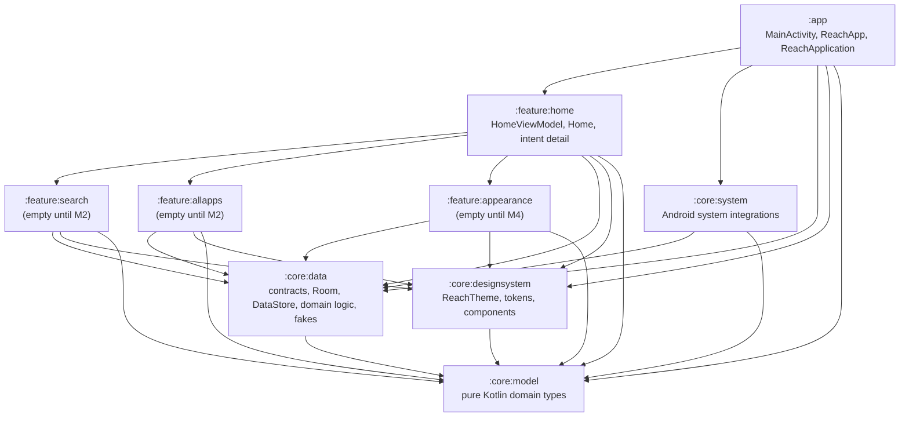
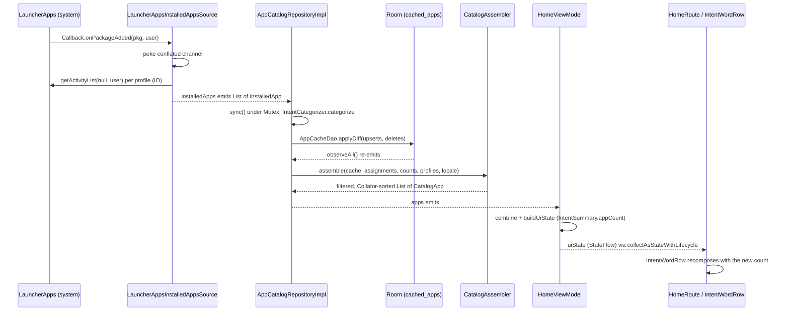
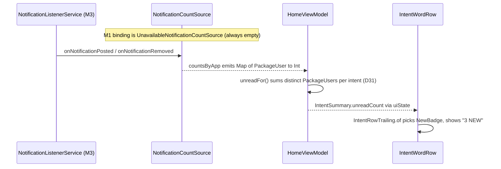
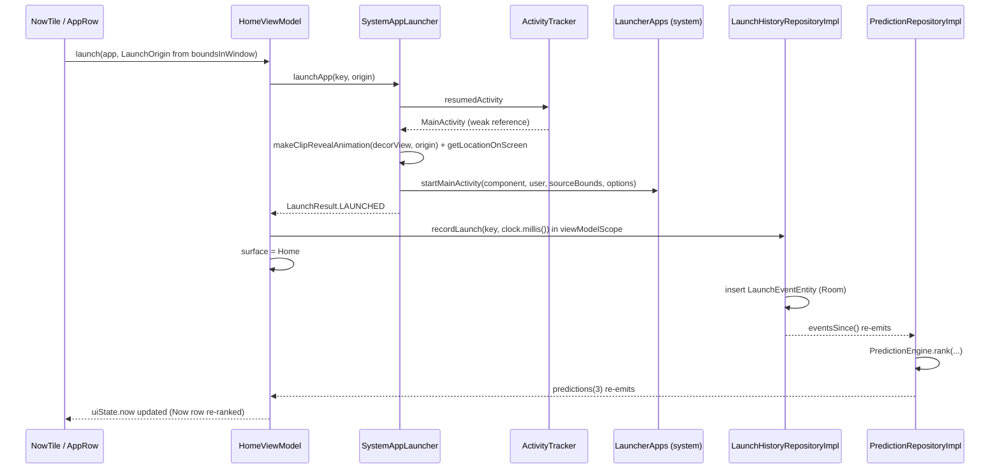
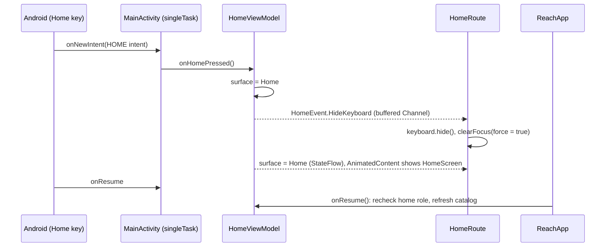
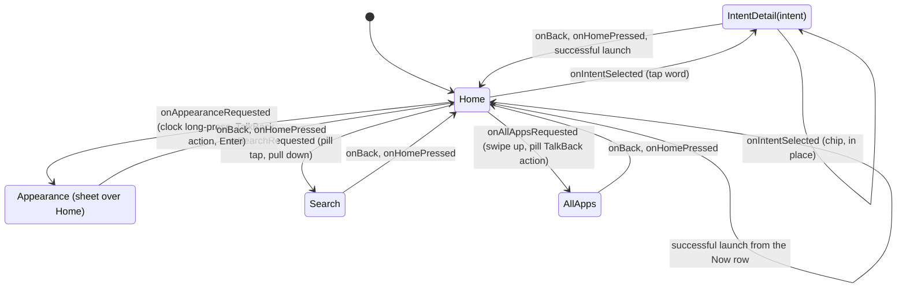

# Reach — architecture

**v1 (M1).** Describes the code as it is at the end of milestone M1 ("Core launcher").
Things that don't exist yet are marked with the milestone that brings them. The product
spec is [`reach-launcher-prompt.md`](reach-launcher-prompt.md); the reasons behind the
choices are in [`DECISIONS.md`](DECISIONS.md) (D1–D33); the Flutter → Compose vocabulary
is in [`FLUTTER_TO_COMPOSE.md`](FLUTTER_TO_COMPOSE.md).

Paths below are abbreviated: `…` = the `src/main/kotlin/com/baklavapp/reachlauncher/<module>`
part, e.g. `core/data/…/db/` = `core/data/src/main/kotlin/com/baklavapp/reachlauncher/core/data/db/`.

---

## 1. Modules

The edges are exactly the `project(":…")` dependencies in each module's `build.gradle.kts`.
`:core:data` and `:core:designsystem` re-export `:core:model` with `api(…)`, so the direct
`--> model` edges from features are technically redundant but are declared anyway for
readability.

| Module | Kind | What lives there (M1) |
|---|---|---|
| `:app` | Android application | `MainActivity` (HOME activity), `ReachApp` (root composable), `ReachApplication` (`@HiltAndroidApp`), the manifest, window theme, backup rules |
| `:core:model` | **pure Kotlin/JVM** (no Android) | `AppKey`, `PackageUser`, `CatalogApp`, `InstalledApp`, `ProfileState`, `ReachIntent`, `LaunchEvent`, `Prediction`, `AppearanceSettings`, `LaunchOrigin`, `SystemScreen`, `ExternalAction`, `TextFolding`… |
| `:core:designsystem` | Android library + Compose | `ReachTheme`, palettes, derived tokens, `ColorMath`, typography + fonts, components (`IntentWordRow`, `NowTile`, `AppRow`, `SearchPill`, `Monogram`, `reachClickable`…) |
| `:core:data` | Android library | **Contracts** (`repository/Repositories.kt`, `source/SystemSources.kt`), their **implementations** for data (`repository/impl`, `db`, `domain`, `time`), Hilt modules (`di`), and **fakes** (`fake`, in `src/main` — D4) |
| `:core:system` | Android library | Implementations of the system-source contracts (`LauncherAppsInstalledAppsSource`, `UserManagerProfileSource`, `SystemAppLauncher`, `TelephonyDefaultAppsSource`, `RoleHomeRoleSource`, `Unavailable…` stubs), `ActivityTracker`, `SystemModule` |
| `:feature:home` | Android library + Compose | `HomeViewModel` (the surface state machine), `HomeRoute`, Home and intent-detail screens, placeholders for Search / All Apps / Appearance |
| `:feature:search`, `:feature:allapps`, `:feature:appearance` | Android library + Compose | Build files only. Their surfaces are placeholders inside `:feature:home` (`ui/PlaceholderSurfaces.kt`) until M2 / M2 / M4 |

### Dependency rules and why

1. **Features never import `:core:system`.** Look at `feature/*/build.gradle.kts`: none
   of them lists it. A feature can only reach Android through the interfaces in
   `:core:data/…/source/SystemSources.kt` (D3). Consequences:
   - `HomeViewModelTest` is a plain JVM test with fakes (`HomeTestFixtures.kt` builds the
     ViewModel from `FakeAppCatalogRepository`, `FakeAppLauncher`, …).
   - Every system integration is optional: in M1, eight of the thirteen sources are
     `Unavailable…` stubs and Home works anyway.
2. **Contracts live in `:core:data`, not in `:core:system`.** `:core:system` depends on
   `:core:data` to implement them (dependency inversion). Flutter analogy: the
   `*_platform_interface` package of a federated plugin.
3. **No Android types in contracts** (D11). They use domain types such as `LaunchOrigin`
   (four ints), `SystemScreen` (an enum) and `ExternalAction` (a sealed interface) instead
   of `Intent`, `View` or `Rect`. On the plain JVM, `android.content.Intent` can't even be
   constructed, so an `Intent` in a contract would push every ViewModel test onto
   Robolectric.
4. **`:app` is the only module that sees both sides** and therefore the only place where
   Hilt can assemble the whole graph. The `@Module`s themselves sit next to the code they
   bind (`core/data/…/di/DataModules.kt`, `core/system/…/di/SystemModule.kt`); Hilt
   collects every `@InstallIn(SingletonComponent::class)` module on the classpath of
   `:app` at compile time.
5. **`:core:model` has no Android dependency** (`kotlin.jvm` plugin), so its tests are
   fast JVM tests and it can never leak a platform type.
6. **Feature modules don't depend on each other**, except that `:feature:home` hosts the
   others: Search, All Apps and Appearance are *states* of the Home surface (§4), not
   separate screens.

---

## 2. Layers

Every data path in Reach has the same shape. Here it is next to the Flutter
clean-architecture layers you know:

| Reach layer | Example (M1) | Flutter clean architecture |
|---|---|---|
| Stateless composables | `HomeScreen`, `IntentDetailScreen`, `IntentWordRow`, `NowTile` | widgets (`StatelessWidget` taking state + callbacks) |
| Route (state ↔ UI glue) | `HomeRoute` (collects state, handles events and Back) | `BlocBuilder` / `BlocListener` / `PopScope` around a page |
| ViewModel | `HomeViewModel` — `StateFlow<HomeUiState>`, `Flow<HomeEvent>` | BLoC / Cubit |
| Repository interface | `AppCatalogRepository`, `LaunchHistoryRepository`, `PredictionRepository`, `SettingsRepository` (`core/data/…/repository/Repositories.kt`) | `domain/repositories` abstract classes |
| System-source interface | `InstalledAppsSource`, `ProfileSource`, `AppLauncher`, `NotificationCountSource`… (`core/data/…/source/SystemSources.kt`) | plugin platform interface / abstract data source |
| Pure domain logic | `CatalogAssembler`, `IntentCategorizer`, `PredictionEngine`, `hourTicks` (`core/data/…/domain`, `…/time`) | use cases / pure Dart services |
| Repository implementation | `AppCatalogRepositoryImpl`, `LaunchHistoryRepositoryImpl`, `PredictionRepositoryImpl`, `SettingsRepositoryImpl` | `data/repositories` implementations |
| Data sources | Room (`ReachDatabase`, DAOs), DataStore (`DataStore<Preferences>`), system sources in `:core:system` | drift/sqflite, shared_preferences, platform plugins |

Two things differ from a typical Flutter app:

- **Streams all the way down.** Room DAOs return `Flow`s that re-emit when a table changes
  (≈ drift `watch()`), DataStore's `data` is a `Flow`, system callbacks are wrapped in
  `callbackFlow`. Repositories combine those flows; the ViewModel `combine`s the
  repositories into one `HomeUiState`. Nobody "reloads" — new data simply flows through.
- **Two kinds of lifetime.** `viewModelScope` dies with the ViewModel (≈ `Bloc.close()`);
  `@ApplicationScope` (`CoroutinesModule.provideApplicationScope`, a `SupervisorJob` on
  `Dispatchers.Default`) lives as long as the process. Work that must continue while no
  screen is collecting — keeping the app cache in sync — runs in the application scope.

---

## 3. Data-flow walkthroughs

### 3a. An app is installed → its intent's count on Home updates

1. **System callback.** `LauncherAppsInstalledAppsSource` (`core/system/…/apps/`) builds
   `installedApps` with `callbackFlow`. While collected, it registers a
   `LauncherApps.Callback` (`PokingCallback`, on the main looper) and a broadcast flow for
   the profile actions (`Profiles.profileChangeActions()`). `onPackageAdded` just *pokes*
   a `Channel.CONFLATED`.
2. **Re-read.** A collector on the IO dispatcher turns every poke into `readAll()`:
   `Profiles.visibleProfiles()` → `LauncherApps.getActivityList(null, user)` per profile,
   dropping Reach's own entry and every app of a *locked* private space, mapping
   `ApplicationInfo.category` with `appCategoryOf`. Conflation collapses a burst (an update
   fires remove + add) into one or two reads. `distinctUntilChanged()` drops identical lists.
3. **Catalog sync.** `AppCatalogRepositoryImpl` (`core/data/…/repository/impl/`) collects
   that flow in its `init` block, in the **application scope** (with a capped
   exponential `retryWhen` so a dead binder can't crash Home). `sync()` — serialised by
   a `Mutex` — asks `DefaultAppsSource.talkRolePackages()` for the default dialer/SMS
   (D23), auto-assigns each app with `IntentCategorizer.categorize`, diffs against
   `AppCacheDao.getAll()`, and writes only the difference with `AppCacheDao.applyDiff`
   (one `@Transaction`, so no observer sees a half-applied diff).
4. **Room re-emits.** Room's invalidation tracker notices the `cached_apps` change, so
   `AppCacheDao.observeAll()` emits again.
5. **Assembly.** `AppCatalogRepositoryImpl.apps` `combine`s five flows — the cache,
   `AppAssignmentDao.observeAll()`, `LaunchEventDao.observeCounts()`,
   `ProfileSource.profiles` (started with an empty list, so the first emission needs Room
   only — D35) and the sort locale — and calls `CatalogAssembler.assemble`: drop private-space
   apps unless their profile is known and unlocked (D13/D24), effective intent = user
   choice ?: auto intent, flag paused work apps, sort with `Collator.getInstance(locale)`.
   `distinctUntilChanged()` again, then `shareIn(appScope, WhileSubscribed(5_000,
   replayExpirationMillis = 0), replay = 1)`: Home and the prediction pipeline share one
   assembly (D35).
6. **ViewModel.** `HomeViewModel` combines `catalogRepository.apps` with notification counts
   and shortcuts into a `CatalogSnapshot`, then combines that with settings and predictions.
   `buildUiState` (on `Dispatchers.Default` via `flowOn`) drops hidden apps, groups by intent
   and produces one `IntentSummary(intent, appCount, unreadCount)` per `ReachIntent` (always
   six, even at 0) plus the intent-detail content of all six intents.
   `stateIn(viewModelScope, WhileSubscribed(5_000), HomeUiState())` publishes it. The active
   surface is *not* part of it: it is its own `StateFlow` (D39).
7. **UI.** `HomeRoute` reads it with `collectAsStateWithLifecycle()`. `HomeScreen` →
   `IntentWords` → `IntentWordRow(trailing = IntentRowTrailing.of(appCount, unreadCount))`
   (`IntentRowTrailing.None` until `HomeUiState.catalogLoaded`, so a cold start never shows "0").
   Only the row whose `IntentSummary` changed gets new parameters; Compose skips the others.

Belt and braces: `ReachApp` runs `HomeViewModel.onResume()` on every `ON_RESUME`, which
calls `catalogRepository.refresh()` — a one-shot re-read and sync — because package
callbacks aren't guaranteed while the app is stopped. `refresh()` also re-reads the default
locale, so a language change made in Settings re-sorts the catalog when the user comes back
(Reach handles `locale` config changes itself, D8, so nothing else would).

Failures don't crash Home (D36): `safeSync` swallows (and logs) `SQLiteException`s such as
`SQLiteFullException`, `IllegalStateException` and `SecurityException` and keeps the cache;
a failing *observed* query is retried with back-off on `SQLiteException`; `refresh()` and
`recordLaunch` are guarded in the ViewModel; and the application scope has a logging
`CoroutineExceptionHandler` as the last line of defence.

### 3b. A new notification → "3 NEW" badge (path ready, source arrives in M3)

The spec's example. **In M1 the path exists end to end, but the source is a stub:**
`SystemModule` binds `NotificationCountSource` to `UnavailableNotificationCountSource`
(`core/system/…/unavailable/UnavailableSources.kt`), which emits `isAccessGranted = false`
and `countsByApp = emptyMap()` — exactly what the real source reports when the user hasn't
granted notification access. So no badges show yet.

How it works once M3 lands:

1. A `NotificationListenerService` in `:core:system` (M3) receives posted/removed
   notifications, counts active, non-ongoing ones per **package and profile** (`PackageUser`,
   D12) and exposes `countsByApp: Flow<Map<PackageUser, Int>>`.
2. M3 changes **one line** in `SystemModule`: `bindNotificationCountSource` binds the real
   class instead of the stub. Nothing in `:feature:home` changes.
3. `HomeViewModel` already combines `notificationCountSource.countsByApp` into its
   `CatalogSnapshot`. `buildUiState` → `unreadFor(apps, unread)` sums the counts over the
   **distinct** `PackageUser`s of each intent's visible apps (D31): two launcher activities
   of one app count once, personal and work copies count separately, hidden apps don't count.
4. `IntentRowTrailing.of(appCount, unreadCount)` picks `NewBadge(unreadCount)` when
   `unreadCount > 0` (else `AppCount`). `IntentWordRow` draws the accent badge
   (`ds_badge_new`, e.g. "3 NEW") and folds it into the row's TalkBack description
   ("Talk, 3 new notifications", D19).
5. The same counts reach the intent-detail rows (`AppItem.unreadCount` → `AppRow` badge)
   and predictions: `PredictionRepositoryImpl` also combines `countsByApp`, and
   `PredictionEngine` boosts unread apps and labels them `PredictionReason.Unread` (D25).

Tests already cover the M1 part with fakes: `HomeViewModelTest` — "unread counts are summed
per intent and kept apart per profile", "no notification access means no badges";
`HomeRouteTest.intentRowDescriptionIncludesTheBadge`.

### 3c. Tap an app → launch

1. **Where was the tap?** Every launchable element (`NowTile` on Home, `AppRow` in intent
   detail, shortcut pills) has a `LaunchOriginHolder` (`rememberLaunchOrigin()`) and
   `Modifier.trackLaunchOrigin(holder)`, which records `boundsInWindow()` from
   `onGloballyPositioned` (`feature/home/…/ui/HomeUiSupport.kt`). It's a plain holder, not
   Compose state, because it changes on every scroll frame and nobody reads it until a tap.
2. **ViewModel.** The click calls `HomeViewModel.launch(app, holder.toLaunchOrigin())`.
3. **System launch.** `AppLauncher.launchApp(key, origin)` → `SystemAppLauncher`
   (`core/system/…/launch/`):
   - `Profiles.userFor(serial)` turns the stored user serial back into a `UserHandle`
     (`FAILED` if the profile was removed);
   - profile in quiet mode (checked *live*)? Private space → `FAILED` (stays locked). Paused
     work profile → `UserManager.requestQuietModeEnabled(false, user)` and return
     `RESUMING_PROFILE` *without* launching (D27, D34);
   - `ActivityTracker.resumedActivity` (registered in `ReachApplication`, D11) provides the
     decor view: `ActivityOptions.makeClipRevealAnimation(decorView, …origin)` (window
     coordinates) and `sourceBounds` = `sourceBoundsOnScreen(origin, decorView.getLocationOnScreen())`
     (screen coordinates);
   - `LauncherApps.startMainActivity(component, user, sourceBounds, options)` → `LAUNCHED`.
     `ActivityNotFoundException` / `SecurityException` → `FAILED`.
4. **Outcome in the ViewModel** — it reacts to the `LaunchResult` only, never to the
   catalog's possibly stale `isProfilePaused` (D34):
   - `FAILED` → `HomeEvent.LaunchFailed(label)` on the event channel; `HomeRoute` shows
     "Couldn't open X" for 3 s (a polite live region; a second failure restarts the timer);
     the surface stays.
   - `RESUMING_PROFILE` → nothing else (no history, surface stays; D32).
   - `LAUNCHED` → `onLaunched(key)`: `historyRepository.recordLaunch(key, clock.millis())` in
     `viewModelScope` (best effort: a database error is swallowed, D36), and the surface
     returns to Home (D28).
5. **History → predictions.** `LaunchHistoryRepositoryImpl.recordLaunch` stores a
   `LaunchEventEntity` with hour-of-day and weekday captured in the *current* zone
   (`SystemZoneClock`, D27). Room invalidates `launch_events`, which re-emits two flows:
   - `LaunchEventDao.observeCounts()` → `CatalogApp.launchCount` → intent-detail order
     ("most launched first, then alphabetical").
   - `LaunchEventDao.observeSince(…)` → `PredictionRepositoryImpl` →
     `PredictionEngine.rank(…)` (D25) → `predictions(3)` → `HomeUiState.now` → the Now row.

### 3d. The Home button is pressed

1. The system sends the HOME intent. Because `MainActivity` is `launchMode="singleTask"`
   (`app/src/main/AndroidManifest.xml`), Android reuses the existing instance and calls
   `MainActivity.onNewIntent(intent)` instead of creating a second Home.
2. `onNewIntent` → `HomeViewModel.onHomePressed()` → `_surface.value = HomeSurface.Home` and
   `eventChannel.trySend(HomeEvent.HideKeyboard)` (plus `HomeEvent.ScrollToTop` if Home was
   already showing: Home scrolls back to the top).
3. The event channel is a buffered `Channel`, not a `SharedFlow`, so the event survives even
   if the UI isn't collecting at that instant; `HomeRoute` collects it inside
   `repeatOnLifecycle(STARTED)` and calls `LocalSoftwareKeyboardController.hide()` +
   `focusManager.clearFocus(force = true)`.
4. `HomeRoute` reads `viewModel.surface` — a plain `StateFlow`, separate from `uiState` — so
   even if Reach sat in the background long enough for `uiState`'s `WhileSubscribed(5 s)` to
   stop, the very first resumed frame shows Home (D39). `AnimatedContent` switches to
   `HomeScreen` (Appearance shares Home's content key, so closing the sheet only animates
   the sheet).
5. `ON_RESUME` follows: `ReachApp`'s `LifecycleResumeEffect` calls `onResume()`
   (`homeRoleSource.recheck()` + `catalogRepository.refresh()`), and `rememberWallClock()`
   re-reads the time.

`resumeWhilePausing="true"` lets Home resume while the app being left is still pausing, so
Home appears without waiting for it.

---

## 4. The Home surface state machine

There is one Activity and no Navigation library (D28). `HomeSurface`
(`feature/home/…/HomeSurface.kt`) is a sealed interface with five states; the transitions
are `HomeViewModel` methods.

- **Back** (`BackHandler(enabled = true)` in `HomeRoute`) is *always* consumed: sub-surfaces
  → `onBack()` → Home; on Home it changes nothing. Letting Back through would finish the
  launcher Activity.
- **The on-screen back/close buttons** of intent detail and the placeholders call the same
  `onBack()`.
- **Home button** → `onHomePressed()` from any state (§3d), plus `HideKeyboard`.
- **Successful launch** → Home (so Home, not a stale list, greets the user when they come
  back). A failed launch or a paused-profile tap keeps the current state.
- **Not persisted.** The surface is a plain `MutableStateFlow` in the ViewModel, exposed as
  `HomeViewModel.surface` separately from `uiState` (so it is always current, D39): it
  survives configuration changes (the ViewModel does) but not process death — by design,
  since the manifest says `stateNotNeeded` and Home is always the right state after a
  restart.
- **Rendering.** `HomeRoute.HomeSurfaces` uses `AnimatedContent(targetState =
  HomeFrame(surface, state), contentKey = { it.surface.contentKey() })`. Home and Appearance share the key `"home"` (the
  sheet is drawn *over* Home by a separate `AnimatedVisibility`); all `IntentDetail(…)` states
  share `"detail"`, so a chip switch updates the list in place. With "Remove animations" on
  (`rememberReducedMotion()`), only a cross-fade remains.
- **M1 placeholders.** Search and All Apps render `SearchPlaceholder` / `AllAppsPlaceholder`,
  Appearance renders `AppearancePlaceholderSheet` (`feature/home/…/ui/PlaceholderSurfaces.kt`).
  The real screens arrive in M2 (`:feature:search`, `:feature:allapps`) and M4
  (`:feature:appearance`).
- **Home swipes** come from a `NestedScrollConnection` (`VerticalSwipeConnection` in
  `ui/HomeGestures.kt`, D29): Home scrolls at large font sizes, so pull-down / swipe-up use
  the drag the scroll couldn't consume (72dp past the edge, or a ≥ 1200dp/s flick with ≥ 16dp
  travel) instead of a competing drag detector.

---

## 5. Startup and performance

Spec §4: "Home must render immediately when Home is pressed."

- **Valid first frame.** `HomeUiState()`'s defaults are a complete Home (six intent words,
  `catalogLoaded = false`: no counts and no Now row until the first catalog emission, so a
  cold start never flashes "0"). `stateIn(…, initialValue = HomeUiState())` means the first
  composition never waits for data and never shows a spinner.
- **Cache first.** `AppCatalogRepositoryImpl.apps` needs only Room for its first emission.
  The system query (`LauncherApps`) runs independently in the application scope and only
  *writes* to Room, and the live profile list (`UserManager`) is combined in starting from
  an empty list (D35) — until it answers, private-space apps stay hidden (fail closed) and
  work apps show as not paused. So the cached catalog arrives within milliseconds and fresh
  data follows as a second emission — if anything changed (`applyDiff` writes nothing
  otherwise). Covered by `AppCatalogRepositoryImplTest` "cache is emitted before the system
  answers, then fresh data follows" and "the first emission needs only Room, not the profile
  source".
- **No main-thread I/O.** Room's database file is opened lazily on first query, on a
  background thread (`DatabaseModule.provideDatabase`). Repository flows use
  `flowOn(ioDispatcher)` / `flowOn(defaultDispatcher)`; `getActivityList`, profile and
  role lookups run on `Dispatchers.IO`. DataStore does its own I/O off the main thread.
  The exception is a tap: `SystemAppLauncher.launchApp` runs on the main thread (a couple of
  quick `UserManager` lookups, then `LauncherApps.startMainActivity`, which starts an
  Activity and needs the resumed one anyway).
- **`WhileSubscribed(5_000)`** for `HomeViewModel.uiState`, the shared catalog
  (`AppCatalogRepositoryImpl.apps`, `replayExpirationMillis = 0` so a stale list is never
  replayed) and the shared prediction ranking (`PredictionRepositoryImpl`,
  `shareIn(appScope, WhileSubscribed(5_000), replay = 1)`): upstream work stops 5 s after
  Home goes to the background (no hourly ticks in your pocket) but survives a quick app
  switch without restarting. The surface is deliberately outside this (D39).
- **Ticks without timers.** The clock re-reads time on `ACTION_TIME_TICK` /
  `ACTION_TIME_CHANGED` / `ACTION_TIMEZONE_CHANGED` and on resume (D30). Predictions re-rank
  on hour changes via `hourTicks()`, which sleeps to the next hour (capped at 5 min, D25).
- **No blank frame.** The window theme's `windowBackground` (`app/src/main/res/values*/themes.xml`)
  is the default palette's bg (light `#F4F2EC`, night `#101114`), so the window isn't white
  before Compose's first frame. `configChanges` stops Android from recreating Home on
  rotation, dark mode, font scale or locale changes; Compose recomposes instead (D8).
  Trade-off: the window background doesn't switch if dark mode toggles while Reach runs —
  only visible on the first frame of a cold start.
- **Not yet:** a Baseline Profile (M5). `androidx.profileinstaller` is already a dependency
  of `:app`.

---

## 6. Privacy architecture

- **No network.** No manifest in the project declares `INTERNET`, and none of the
  libraries adds it (checked in the merged debug manifest). Without that permission the
  app cannot open a socket.
- **No backups** (D9). `android:allowBackup="false"`, plus `backup_rules.xml` (Android 9–11)
  and `data_extraction_rules.xml` (Android 12+, cloud backup *and* device-to-device
  transfer) that exclude every domain. Launch history and settings never leave the device.
- **Private space fails closed** (D13, D24). Three layers:
  1. `LauncherAppsInstalledAppsSource.readProfile` returns nothing for a private profile in
     quiet mode (locked).
  2. `Profiles.typeOf` / `classifyProfile`: if `LauncherApps.getLauncherUserInfo` refuses
     to answer (`SecurityException`), the profile is treated as **PRIVATE**.
  3. `CatalogAssembler.assemble` drops every private-space app unless its profile is
     currently *known* and *unlocked* — applied to **every** emission, including the instant
     cached one, so apps cached during an unlocked session can't flash onto Home after the
     space is locked. Before the profile list has arrived, "known" is false for every
     profile, so private apps are hidden then too (D35). Predictions and (from M2) search build on `AppCatalogRepository.apps`
     and inherit this.
  Until M5 adds `ACCESS_HIDDEN_PROFILES`, Android 15+ doesn't show the private space to
  Reach at all, which is the safe default.
- **Own launches only.** Predictions use Reach's own launch history (no permission). Usage
  stats are an optional blend behind `UsageStatsSource`, stubbed until M3.
- **Receivers are not exported.** Every runtime broadcast receiver (clock ticks, profile
  changes) is registered with `RECEIVER_NOT_EXPORTED`, so other apps can't fake those events.

---

## 7. Where to add a new feature

### A new system integration (e.g. M3's notification counts)

1. **Contract** — in `core/data/…/source/SystemSources.kt`, add or extend an interface using
   only `:core:model` types. Define what it reports *without* permission (empty, `false`,
   `null`); it must never throw. New domain types go into `:core:model`.
2. **Fake** — in `core/data/…/fake/FakeSystemSources.kt`, an in-memory implementation backed
   by `MutableStateFlow`s that tests can drive (see `FakeNotificationCountSource`). Add a
   test to `core/data/src/test/…/fake/FakesTest.kt` if the fake has logic.
3. **Implementation** — in `:core:system`, a `@Singleton class … @Inject constructor(
   @ApplicationContext context: Context, …)`. Wrap callbacks/broadcasts in `callbackFlow`
   (see `LauncherAppsInstalledAppsSource`, `util/BroadcastFlow.kt`), do blocking calls on the
   injected `@IoDispatcher`, and catch `SecurityException`. Put any `<uses-permission>`,
   `<service>` or `<queries>` in `core/system/src/main/AndroidManifest.xml`, next to the code.
4. **Binding** — in `core/system/…/di/SystemModule.kt`, `@Binds` the interface to the new
   class (replacing the `Unavailable…` stub if there is one).
5. **Consume** — inject the interface into a ViewModel or repository and `combine` it into
   the state. Features keep depending only on `:core:data`.
6. **Tests** — the pure parts (mapping, intent building) as JVM/Robolectric tests in
   `core/system/src/test` (see `SystemAppLauncherTest`, `ProfileMappingTest`); the
   ViewModel behaviour with the fake in `feature/<x>/src/test`.
7. **Docs** — a section in [`ANDROID_APIS.md`](ANDROID_APIS.md) (what, why, how granted,
   without it, Play policy) and an entry in `DECISIONS.md` if anything is non-obvious.

### A new surface (screen state)

1. Add a case to `HomeSurface` (`feature/home/…/HomeSurface.kt`). The `when`s in `HomeRoute`
   (`HomeSurfaces`, `contentKey`) stop compiling until you handle it — that's the point.
2. Add the transition method(s) to `HomeViewModel` (`fun onXRequested() { _surface.value = … }`)
   and decide what `onBack()` does from it (today: always Home).
3. Write the stateless composable (state in, callbacks out) — in its own feature module if
   it's big (as Search/All Apps/Appearance will be) — and render it from `HomeSurfaces`.
4. Tests: transitions in `HomeViewModelTest` (Turbine), the UI in `HomeRouteTest`
   (`createAndroidComposeRule` + Robolectric; it also gives you the Activity for system Back).

### A new setting

1. Add the field with a default to `AppearanceSettings` (`core/model/…/Appearance.kt`). If
   it's an enum, give it a stable `storageKey` + `fromStorageKey` with a default fallback
   (never persist `name`/ordinal) and extend `StorageKeyTest`.
2. Add a setter to `SettingsRepository` (`Repositories.kt`), implement it in
   `SettingsRepositoryImpl` with a new key in its private `Keys` object (never rename the
   string later — it's what's on disk) and map it in `toSettings()`.
3. Update `FakeSettingsRepository` and `SettingsRepositoryImplTest`.
4. Read it from `HomeViewModel` via `settingsRepository.settings` → `HomeUiState`, and add the
   control to the Appearance sheet (M4).

### Where tests go

| What | Where | Runner |
|---|---|---|
| Pure domain types and helpers | `core/model/src/test` | plain JUnit |
| Colour maths, contrast, monograms | `core/designsystem/src/test` | plain JUnit |
| Repositories, Room, DataStore, predictions | `core/data/src/test` | Robolectric for Room (in-memory database), plain JVM for DataStore (a temp file) and predictions (fakes); Turbine + `runTest` |
| System-source mapping and intents | `core/system/src/test` | Robolectric |
| ViewModels | `feature/<x>/src/test` | plain JUnit + fakes + Turbine |
| Compose UI flows | `feature/<x>/src/test` | Robolectric + `createComposeRule()` |

Run them all with `./gradlew test`, or one module with `./gradlew :feature:home:test`.
