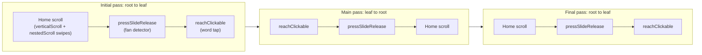
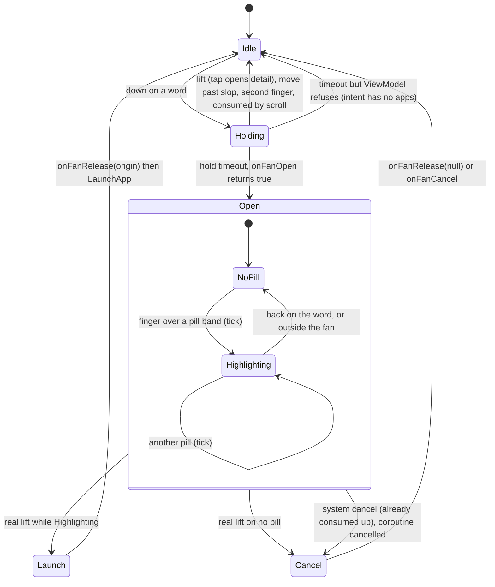

# Reach — gestures, step by step

**v2 (M4).** How Reach's custom touch handling works, written for a Flutter developer:
press-slide-release on Home (spec §6.5), the All Apps letter rail (§6.7), Home's pull-down /
swipe-up (§6.3) and the clock's long-press. Everything here describes code that exists at
the end of M4 (M4 added the intent-detail app-row long-press, §5a); the reasons are in [`DECISIONS.md`](DECISIONS.md) (D29, D30, D41, D48–D50, D64).
The general Flutter → Compose vocabulary is in [`FLUTTER_TO_COMPOSE.md`](FLUTTER_TO_COMPOSE.md).

Paths are abbreviated: `feature/home/…/ui/` = `feature/home/src/main/kotlin/com/baklavapp/reachlauncher/feature/home/ui/`.
Code excerpts are trimmed ("simplified from …"); the real files have more comments and edge cases.

| Gesture | Where | Detector |
|---|---|---|
| Press, slide, release | `feature/home/…/ui/PressSlideRelease.kt` (+ `FanOverlay.kt`, `HomeWithFan.kt`) | hand-written `pointerInput` + `awaitEachGesture` |
| Letter rail scrub | `feature/allapps/…/ui/LetterRail.kt` | hand-written `pointerInput` + `awaitEachGesture` |
| Pull down → Search, swipe up → All Apps | `feature/home/…/ui/HomeGestures.kt` | `NestedScrollConnection` on Home's scroll |
| Clock long-press → Appearance | `feature/home/…/ui/HomeClock.kt` | stock `detectTapGestures(onLongPress = …)` |
| Long-press a name in All Apps → menu | `feature/allapps/…/ui/AllAppsScreen.kt` | stock `combinedClickable` (via `reachClickable(onLongClick = …)`) |
| Long-press an app row in intent detail → the same menu (M4) | `feature/home/…/ui/IntentDetailScreen.kt` | same `reachClickable(onLongClick = …)`; menu is `AppActionsMenu` from `:core:designsystem` |

---

## 1. Compose's pointer model, for a Flutter developer

### Detectors are coroutines, not callback objects

In Flutter you either use `GestureDetector(onTap:, onLongPress:, onVerticalDragUpdate:)` or,
for something custom, a `RawGestureDetector` with your own `GestureRecognizer` subclass that
overrides `addAllowedPointer`, `handleEvent`, `acceptGesture`, `rejectGesture` — a state
machine spread over callbacks.

Compose's low-level equivalent is `Modifier.pointerInput(keys) { … }`. The block is a
**suspending coroutine** in which you *wait* for events in sequence:

```kotlin
// illustrative
Modifier.pointerInput(Unit) {
    awaitEachGesture {                       // restarts for every gesture (first down → all up)
        val down = awaitFirstDown()          // suspends until a finger touches
        while (true) {
            val event = awaitPointerEvent()  // suspends until the next move/up
            val change = event.changes.first { it.id == down.id }
            if (!change.pressed) break       // finger lifted
            // … react to change.position …
        }
    }
}
```

So the state machine becomes straight-line code: "wait for a down, then wait 300 ms or a
move, then follow the finger". `awaitEachGesture` is like a recognizer that resets itself after
each gesture. The stock helpers (`detectTapGestures`, `detectDragGestures`, `clickable`,
`combinedClickable`, `verticalScroll`) are written the same way — they're just library code.

### The three passes

Compose hit-tests a touch like Flutter does (which nodes are under the finger), but then
delivers each pointer event along that path **three times**:

1. **`PointerEventPass.Initial`** — root → leaf. A parent sees the event *before* its
   children: the place to intercept.
2. **`PointerEventPass.Main`** — leaf → root. The normal pass (`awaitPointerEvent()`'s
   default): the innermost handler (a button) reacts first, then its ancestors (a scroll).
3. **`PointerEventPass.Final`** — root → leaf again, to see what everyone decided.

**Modifier order makes the tree.** In a chain, a modifier written *earlier* is the *parent*
of the ones after it. `IntentWordRow` (`core/designsystem/…/component/IntentWordRow.kt`)
applies the caller's `wordModifier` **before** its own `reachClickable`, so for a touch on an
intent word the path is:



### Consumption instead of a gesture arena

Flutter has a **referee**: recognizers join the gesture arena, one declares victory
(`resolve(GestureDisposition.accepted)`) and the others get `rejectGesture`.

Compose has **no referee**. Every detector on the path sees every event. Instead there's a
convention: calling `change.consume()` marks a `PointerInputChange` as used, and well-behaved
detectors (`clickable`, `verticalScroll`, `detectTapGestures`, ours) **ignore or abandon
changes someone else consumed**. Consuming is how you say "this one is mine" — the
equivalent of winning the arena. Combined with the passes: consume in `Initial` and you beat
your children *and* your ancestors (they react in `Main`); consume in `Main` and you only beat
your ancestors.

`awaitFirstDown(requireUnconsumed = false)` means "give me the down even if a child already
consumed it" — needed because `clickable` consumes the down for its pressed/ripple state.

---

## 2. Press, slide, release (Home)

**What the user does:** hold an intent word (~300 ms); its apps fan upward beside the thumb;
slide onto one (it lights up, with a haptic tick); lift to open it. Lifting anywhere else, or
sliding back onto the word, cancels. A plain tap still opens the intent detail.

The work is split in two (D50):

| Half | Owns | Where |
|---|---|---|
| ViewModel | *which* apps the fan shows (intent's visible apps in detail order — launch count, then alphabetical — capped at `FanState.MAX_APPS` = 6), which one is highlighted, what release does (launch through `LaunchApp`) | `HomeViewModel.fan: StateFlow<FanState?>`, `onFanOpen` / `onFanHighlight` / `onFanRelease` / `onFanCancel` (`feature/home/…/HomeViewModel.kt`) |
| UI | pixels: pointer tracking, the word's and pills' window bounds, hit-testing, pill layout, haptics | `PressSlideReleaseState` + `Modifier.pressSlideRelease` (`PressSlideRelease.kt`), `FanOverlay` (`FanOverlay.kt`) |

`HomeWithFan` (`HomeWithFan.kt`) glues them: a `Box` with `HomeScreen` and `FanOverlay` on top
(≈ a Flutter `Stack`), both reading one `PressSlideReleaseState` (≈ the `State` object a custom
recognizer and a painter would share).



### Step 0 — Attachment

`HomeScreen` takes a `wordModifier: (ReachIntent) -> Modifier` hook; `HomeWithFan` passes
`{ intent -> Modifier.pressSlideRelease(intent, gesture) }`. Because `IntentWordRow` applies it
before `reachClickable`, the detector is the **parent** of the word's click and a **child** of
Home's scroll (D49). It also records each word's `LayoutCoordinates` with
`onGloballyPositioned`, to convert positions to window pixels later.

```kotlin
// simplified from PressSlideRelease.kt
internal fun Modifier.pressSlideRelease(intent: ReachIntent, state: PressSlideReleaseState): Modifier =
    onGloballyPositioned { state.wordCoordinates[intent] = it }
        .pointerInput(intent, state) {
            val hold = fanHoldMillis(viewConfiguration.longPressTimeoutMillis)
            val slop = viewConfiguration.touchSlop
            awaitEachGesture {
                val down = awaitFirstDown(requireUnconsumed = false)              // 1. down
                val gaveUp = withTimeoutOrNull(hold) { awaitGiveUp(down, slop) }  // 2. hold
                if (gaveUp != null) return@awaitEachGesture
                val coordinates = state.wordCoordinates[intent]?.takeIf { it.isAttached } ?: return@awaitEachGesture
                val press = coordinates.localToWindow(/* current finger position */ down.position)
                if (!state.open(intent, coordinates.boundsInWindow(), press)) return@awaitEachGesture // 3. open
                trackFan(down.id, coordinates, state)                              // 4–6. track
            }
        }
```

### Step 1 — Down

`awaitFirstDown(requireUnconsumed = false)`: the word's `combinedClickable` (a child) has
already consumed the down for its pressed state in `Main`; we still want to see it.

### Step 2 — Hold, without consuming anything

`withTimeoutOrNull(hold) { awaitGiveUp(down, slop) }` races a timer against `awaitGiveUp`,
which watches the pointer in **`Main`** and returns as soon as the press is *not* a hold:

```kotlin
// simplified from PressSlideRelease.kt
private suspend fun AwaitPointerEventScope.awaitGiveUp(down: PointerInputChange, slop: Float) {
    while (true) {
        val event = awaitPointerEvent(PointerEventPass.Main)
        val change = event.changes.firstOrNull { it.id == down.id } ?: return
        val otherFinger = event.changes.any { it.id != down.id && it.pressed }
        if (!change.pressed || change.isConsumed || otherFinger) return          // lifted / taken / pinch
        if ((change.position - down.position).getDistance() > slop) return      // started scrolling
    }
}
```

`null` from `withTimeoutOrNull` means the timer fired with the finger still in place. Until
then **nothing is consumed**, so a tap reaches `reachClickable` (→ intent detail, the
accessible path) and a drag reaches Home's scroll exactly as if the fan didn't exist.
`viewConfiguration.touchSlop` ≈ Flutter's `kTouchSlop`.

**How long is "hold"?** `fanHoldMillis(systemLongPressMillis)` (D48): 300 ms (`FAN_HOLD_MILLIS`)
while the system long-press timeout is a platform default (≤ 500 ms — it's 400 ms since
Android 12, 500 ms before); otherwise the user's own longer accessibility "Touch & hold delay".
300 ms feels instant but is well above a tap (~100 ms); a user who set a 1 s delay needs more
time to lift a tap, so the fan must never be faster than their setting. Tested in
`PressSlideReleaseStateTest` ("hold time is 300 ms unless the user chose a longer
touch-and-hold delay").

### Step 3 — Arm: open the fan

`state.open(intent, wordBounds, press)` calls `HomeViewModel.onFanOpen(intent)`. The ViewModel
returns `false` for an intent with no visible apps — then the gesture bows out and nothing has
been consumed. Otherwise it sets `fan = FanState(intent, apps, highlighted = null)`, and the
UI state stores a `FanAnchor(wordBounds, press)` (Compose state, so the overlay recomposes).
`HomeScreen(heldIntent = …)` then turns the held word `accentInk`, the others `dim`, hides the
counts and swaps the search pill for "RELEASE TO OPEN · SLIDE OFF TO CANCEL".

### Step 4 — Track: read in `Initial`, consume everything

From now on every event is read in **`Initial`** and **every change is consumed**:

```kotlin
// simplified from PressSlideRelease.kt (trackFan)
var finished = false
try {
    while (true) {
        val event = awaitPointerEvent(PointerEventPass.Initial)
        val change = event.changes.firstOrNull { it.id == pointer }
        val cancelledBySystem = change?.isConsumed == true   // read *before* we consume (step 6)
        event.changes.forEach { it.consume() }
        when {
            change == null || cancelledBySystem -> { state.cancel(); finished = true; return }
            !change.pressed -> { state.release(); finished = true; return }
            word.isAttached -> state.moveTo(word.localToWindow(change.position))
        }
    }
} finally {
    if (!finished) state.cancel()   // the coroutine itself was cancelled
}
```

Why `Initial`: the click reacts in `Main` *after* us, and so does the scroll. Both see
consumed changes and stand down — the click doesn't fire on lift, the scroll doesn't drag, and
therefore no nested-scroll leftovers reach the swipe detector (§4). Verified by
`PressSlideReleaseTest.verticalMovementInTheFanDoesNotTriggerHomeSwipes` and
`slidingBackOntoTheWordCancels` (asserts the surface stays Home, i.e. the tap was suppressed).

### Step 5 — Hit bands and the haptic tick

`PressSlideReleaseState.moveTo(windowPosition)` hit-tests against the pills' window bounds,
which `FanOverlay`'s layout reports back on every placement (`recordPills`). The test is
forgiving on purpose (D49) — a thumb sliding up drifts sideways:

```kotlin
// simplified from PressSlideRelease.kt
internal fun hitTest(p: Offset): Int? {
    val anchor = anchor ?: return null
    if (pills.isEmpty() || anchor.wordBounds.contains(p)) return null   // the word = cancel zone
    val left = pills.minOf { it.left } - hitSlopPx                     // fan width ± 24dp
    val right = pills.maxOf { it.right } + hitSlopPx
    if (p.x !in left..right) return null
    val halfGap = pillGapPx / 2                                         // pill height ± half the 10dp gap
    return pills.indexOfFirst { p.y in (it.top - halfGap)..(it.bottom + halfGap) }.takeIf { it >= 0 }
}
```

When the index changes, `onFanHighlight(index)` updates the ViewModel and — only when it
lands on a pill — `rememberHapticTick()` plays one tick (§ Haptics below). Tested in
`PressSlideReleaseStateTest` ("hit test uses bands, the word cancels, outside the fan
cancels", "each new pill ticks once and release launches from its bounds").

### Step 6 — Release vs. system cancel, and cleanup

- **Real lift** → the up arrives *unconsumed* in `Initial` → `state.release()` →
  `onFanRelease(origin)`, where `origin` is the highlighted pill's bounds (for the clip-reveal
  launch animation) or `null`. The ViewModel closes the fan and, if a pill was highlighted,
  calls `launch(app, origin)` → `LaunchApp` — the same path as a tap (see
  [ARCHITECTURE.md §3c](ARCHITECTURE.md)).
- **System cancel** (a system gesture, a dialog, the window losing focus): Compose delivers a
  synthetic "all pointers up" whose changes are **already consumed**. That's the only way to
  tell it from a real lift, so `trackFan` reads `isConsumed` *before* consuming. A cancel never
  launches (D49; `PressSlideReleaseTest.aSystemCancelNeverLaunches` uses `performTouchInput { cancel() }`).
- **Coroutine cancelled** (Home leaves the composition mid-gesture, the `pointerInput` keys
  change): the `finally` closes the fan. `HomeWithFan` additionally has
  `DisposableEffect(gesture) { onDispose { if (gesture.anchor != null) cancel.value() } }`.
- **ViewModel closes first** (Home pressed with a finger down): `onBack`/`onHomePressed` set
  `fan = null`; `HomeWithFan` only shows the overlay while *both* halves agree
  (`fan?.takeIf { gesture.anchor != null }`), so the still-running gesture runs out harmlessly.

### Fan layout (D50)

`FanOverlay` is a custom `Layout { measurables, constraints -> … }` (≈ a
`CustomMultiChildLayout` delegate) filling the window:

- pill 0 (most-used) sits just above the held word, nearest the finger; each next pill is
  higher (10dp gap) and 16dp further from the thumb's edge — the arc a pivoting thumb follows.
  Mirrored for `ThumbSide.RIGHT` (`rightThumbSideMirrorsTheFanAndStillLaunches`).
- pills are ≥ 52dp tall, 168–300dp wide (one common width), kept inside
  `WindowInsets.safeDrawing.union(WindowInsets.systemGestures)` + 8dp, so none sits under the
  status bar, a cutout or the back-gesture strip;
- only pills that fit between the word and the top inset are placed (fewer at 200 % font);
  unplaced pills aren't drawn, hit-tested or exposed to TalkBack;
- highlighted = accent fill, `onAccent` text, a 6dp accent halo at 32 % alpha (`drawBehind`).

### Reduced motion

Each pill fades in and rises 12dp, staggered 30 ms per pill (`Animatable` read in
`graphicsLayer`, so no recomposition per frame). With "Remove animations" on
(`rememberReducedMotion()`, `core/designsystem/…/util/Motion.kt`) the `Animatable` starts at 1
and nothing animates. There is no exit animation: the overlay disappears the moment the fan
closes.

### Accessibility

The gesture is an enhancement (spec §6.5): a tap always opens the intent detail, which is what
TalkBack users use. TalkBack's double-tap-and-hold *does* deliver a long, still press, so it can
open the fan — but lifting without sliding lands on no pill and cancels; the user is never
stuck (`PressSlideReleaseTest.aTalkBackStyleHoldWithoutSlidingDoesNotTrapTheUser`). While
closed, the overlay has no semantics nodes; while open each pill is one node (app name,
`selected` when highlighted). D49 notes a possible later refinement: disabling the gesture
while touch exploration is on.

### Edges

The gesture always *starts* on an intent word, inside Home's 24dp gutter and the
`safeDrawing` insets, so it never begins in the system back-gesture zone; once a gesture has
started inside the app the system doesn't turn it into Back. The pills avoid
`systemGestures` too (above).

---

## 3. The letter rail (All Apps)

`LetterRail` (`feature/allapps/…/ui/LetterRail.kt`) is a 32dp strip of mono letters on the
thumb side. Scrub it to jump through the word wall.

1. **Equal slots.** The rail is a `Column` whose letters each get `Modifier.weight(1f)`, so
   letter *i* of *n* owns `[i·h/n, (i+1)·h/n)` of the rail height *h*. Mapping a finger to a
   slot is then a division, independent of how big letters are drawn:
   `slot = ⌊y / h · n⌋`, clamped to `0 … n−1`.
2. **Large fonts.** A `rememberTextMeasurer()` measures one letter ("W") at the current font
   scale. If it's taller than a slot, only every *k*-th letter is drawn, with
   `k = ⌈letter height / slot height⌉`; the rest become 3dp dots (when they fit). Every letter
   stays reachable by scrubbing — the bubble names it (`railWorksOnTheLeftAndAtFontScale200`).
3. **The gesture loop.**

   ```kotlin
   // simplified from LetterRail.kt
   .pointerInput(Unit) {
       awaitEachGesture {
           val down = awaitFirstDown(requireUnconsumed = false)
           down.consume()                                  // nothing behind the rail reacts
           fun update(y: Float) {
               fingerY = y
               val letter = railLetterAt(currentLetters, y, size.height.toFloat())
               if (letter != null && letter != lastLetter) {
                   lastLetter = letter
                   currentTick()                           // haptic tick
                   currentOnChange(letter)                 // screen scrolls + highlights
               }
           }
           try {
               update(down.position.y)
               while (true) {
                   val change = awaitPointerEvent().changes.firstOrNull { it.id == down.id } ?: break
                   change.consume()
                   if (!change.pressed) break
                   update(change.position.y)
               }
           } finally {
               lastLetter = null
               currentOnChange(null)                       // bubble disappears (also on cancel)
           }
       }
   }
   ```

   `pointerInput(Unit)` starts once and lives across recompositions, so it reads `letters`,
   `onLetterChange` and the tick through `rememberUpdatedState` (≈ reading `widget.x` from a
   `State` instead of capturing it in `initState`).
4. **Skip empty letters.** `railLetterAt(letters, y, height)` is a pure function: the letter
   in the slot under the finger, or — if it has no apps — the nearest letter that has (the
   earlier one on a tie); `null` if none has apps. Empty letters are drawn `dim` (D40).
5. **Feedback.** On a new letter: a haptic tick, the 72dp accent `Bubble` moves next to the
   finger (offset by `fingerY`, on the side away from the edge) showing the letter, and the
   screen highlights that group and dims the others.
6. **Scrolling.** `AllAppsScreen` turns each change into `jump = JumpRequest(groupIndex)` and
   runs `LaunchedEffect(jump) { if (reducedMotion) listState.scrollToItem(item) else listState.animateScrollToItem(item) }`
   (`item` = group index + 1; item 0 is the heading). `JumpRequest` is deliberately **not** a
   data class: two requests for the same group are unequal, so scrubbing back to S after
   scrolling away scrolls again. A new request restarts the effect, cancelling a scroll still
   in flight (≈ calling `animateTo` again on a `ScrollController`). It's kept apart from
   `activeLetter` so lifting the finger (`activeLetter → null`) doesn't cancel the last scroll.
7. **The system back gesture (D41).** The rail would sit right on the back-swipe strip. So
   `AllAppsScreen` pads it by `WindowInsets.systemGestures.exclude(WindowInsets.safeDrawing)`
   on the thumb side (+ 4dp), and the rail also calls `Modifier.systemGestureExclusion()` as a
   backup for devices whose real zone is wider than reported. Android caps exclusions at 200dp
   per edge — the home activity is exempt, but insetting keeps Back working along the whole
   edge and doesn't depend on Reach being the default home.
8. **TalkBack.** ~30 tiny targets would be useless, so the strip is
   `clearAndSetSemantics { contentDescription = "Letter index"; customActions = … }` with one
   "Jump to X" `CustomAccessibilityAction` per letter that has apps (`onJump` →
   `scrollToItem`). The bubble is `hideFromAccessibility()`. Group labels on the wall are
   headings, so heading navigation works too (`railOffersJumpActionsForTalkBack`).

---

## 4. Home swipes: pull down → Search, swipe up → All Apps (D29)

Home scrolls (at 200 % font it doesn't fit — spec §6.10). A second vertical drag detector
(`detectVerticalDragGestures`, ≈ `GestureDetector(onVerticalDragUpdate:)`) would fight
`verticalScroll` for the same drags. Instead `HomeGestures.kt` listens to the scroll's
**nested-scroll leftovers** (≈ Flutter's `NotificationListener<OverscrollNotification>`):

```kotlin
// simplified from HomeGestures.kt (VerticalSwipeConnection)
override fun onPostScroll(consumed: Offset, available: Offset, source: NestedScrollSource): Offset {
    if (source != NestedScrollSource.UserInput || fired) return Offset.Zero
    if (consumed.y != 0f) accumulated = 0f           // content scrolled: measure from the edge it reached
    accumulated += available.y                       // what the scroll couldn't use (+ = finger down)
    when {
        accumulated >= distancePx -> fire(down = true)    // 72dp → onSearch
        accumulated <= -distancePx -> fire(down = false)  // 72dp → onAllApps
    }
    return Offset.Zero
}
override suspend fun onPreFling(available: Velocity): Velocity {
    // finger lifted: a ≥ 1200dp/s flick with ≥ 16dp travel also counts; then reset
}
```

`HomeScreen` attaches it with `.nestedScroll(swipe)` *above* `.verticalScroll(scroll,
overscrollEffect = null)` (no overscroll stretch on Home). When Home fits on screen the scroll
consumes nothing, so all drag is leftover; when it scrolls, only the part past the top/bottom
edge counts. Taps and the clock's long-press never reach this code, because the scroll only
claims the pointer after the touch slop (`HomeRouteTest.tapAndLongPressOnTheClockDontSwipe`).

**While the fan is open** the fan consumes every change in `Initial` (§2 step 4), so the scroll
never drags and produces no leftovers — no accidental Search/All Apps. TalkBack users get
"All apps" as a custom action on the search pill, since swipe-up has no tap equivalent.
Tested by `HomeRouteTest.pullDownOpensSearchAndSwipeUpOpensAllApps`.

---

## 5. Clock long-press (D30)

`HomeClock` uses the stock `detectTapGestures(onLongPress = { haptics.performHapticFeedback(HapticFeedbackType.LongPress); open() })`.
The timeout is `max(450 ms, system long-press timeout)`, applied by overriding
`LocalViewConfiguration` around the clock (`object : ViewConfiguration by baseConfiguration
{ override val longPressTimeoutMillis … }`) — the same "never shorter than the user's Touch &
hold delay" rule as the fan. The accessible paths are a long-click semantics action, an
"Appearance" custom action and Enter/Space on a hardware keyboard.

### 5a. App-row long-press in intent detail (M4, D64)

Intent detail's app rows use the same stock long-press as All Apps (`reachClickable(onLongClick = …,
onLongClickLabel = appMenuOpenLabel())`) and open the same `AppActionsMenu` (`core/designsystem/…/component/AppActionsMenu.kt`):
App info, Move to intent…, Hide, Uninstall. Detail lists only visible apps, so it offers
"Hide" only; unhiding stays in All Apps' "Hidden" group. There is no gesture to learn for
TalkBack: `appMenuAccessibilityActions(…)` adds each of those four as a direct custom action on the
row (≈ Flutter's `Semantics(customSemanticsActions: …)`), plus "App options" for the menu
itself, so nobody has to find the long-press. The `AppActionsMenu` claims system Back while open.
Clock long-press → Appearance (§5) was already wired in M2 and still is; M4 only replaced the sheet
it opens (the real `AppearanceRoute`).

---

## Haptics

`rememberHapticTick()` (`core/designsystem/…/util/Motion.kt`) returns a lambda that calls
`LocalHapticFeedback.current.performHapticFeedback(HapticFeedbackType.SegmentTick)` — Compose's
semantic type for stepping through discrete values (≈ Flutter's
`HapticFeedback.selectionClick()`). Used by the fan (one tick per new pill) and the rail (one
tick per new letter). It goes through `View.performHapticFeedback`, so no `VIBRATE`
permission is needed, and it respects the user's system "touch feedback" setting.

---

## 6. Testing gestures

The UI tests are JVM tests on **Robolectric** (`@RunWith(RobolectricTestRunner::class)`, e.g.
`@Config(qualifiers = "w411dp-h891dp-xxhdpi")`) that inject **real pointer events** into the
composition — the same events a finger produces, through all three passes:

| Compose test (`performTouchInput { … }`) | Flutter `WidgetTester` |
|---|---|
| `down(center)` | `final g = await tester.startGesture(tester.getCenter(finder));` |
| `advanceEventTime(ms)` — timestamps the *next* event | the duration between your `pump`s |
| `composeRule.mainClock.advanceTimeBy(ms)` — runs timers (the hold) | `await tester.pump(const Duration(milliseconds: 350));` |
| `moveTo(offset)` / `moveBy(delta)` | `await g.moveTo(offset)` / `g.moveBy(delta)` |
| `up()` | `await g.up();` |
| `cancel()` | `await g.cancel();` |
| `swipeUp()` / `swipeDown()` | `await tester.fling(finder, const Offset(0, -300), 1000);` |
| `composeRule.waitForIdle()` | `await tester.pumpAndSettle();` |

Holding (from `feature/home/src/test/…/PressSlideReleaseTest.kt`):

```kotlin
// simplified from PressSlideReleaseTest.kt
word("Talk").performTouchInput {
    down(center)
    advanceEventTime(HOLD_MILLIS)            // 350 ms
}
// advanceEventTime only stamps the *next* event; with the finger resting there is no next
// event, so move the test clock ourselves to let the hold timer fire.
composeRule.mainClock.advanceTimeBy(HOLD_MILLIS)
composeRule.waitForIdle()
fanPill("Messages").assertIsDisplayed()
```

Sliding uses `moveTo` in 8 steps (so the slop and the hit bands see intermediate positions),
then `up()`, then asserts on the fakes (`fixture.launcher.launched`, `fixture.history.events`)
and on semantics (`assertIsSelected()` for the highlighted pill — the pill's `selected`
semantics exist for exactly this and for TalkBack).

What's verified:

- `PressSlideReleaseTest` — a short press is still a tap; hold → fan + hint, slide highlights,
  release launches and records history; sliding back onto the word cancels (and suppresses the
  tap); vertical movement in the fan doesn't swipe Home; a system cancel never launches; a
  TalkBack-style hold doesn't trap the user; a failed launch from the fan shows the message;
  the right-thumb mirror works.
- `PressSlideReleaseStateTest` (plain JVM) — hold timing, hit bands, one tick per new pill,
  release/cancel semantics.
- `AllAppsScreenTest` — scrubbing to a letter shows the bubble and scrolls to the group
  (`scrubbingTheRailJumpsToTheGroupAndShowsTheBubble`), also on the left and at 200 % font;
  "Jump to K" works for TalkBack.
- `HomeRouteTest` — pull-down / swipe-up, tap and long-press on the clock don't swipe.

The haptic call itself isn't asserted in UI tests; `PressSlideReleaseStateTest` checks the tick
lambda is invoked once per new pill.

---

## 7. Gotchas for a Flutter developer

- **No arena, no `rejectGesture`.** Nobody tells your detector it lost. Check
  `change.isConsumed` yourself (as `awaitGiveUp` does) and bow out.
- **Modifier order is tree order.** `Modifier.a().b()` makes `a` the parent of `b`. Swap
  `wordModifier` and `reachClickable` and the fan could no longer suppress the tap from
  `Initial`.
- **`awaitPointerEvent()` defaults to `Main`.** To intercept before children (and ancestors),
  pass `PointerEventPass.Initial` explicitly.
- **A system cancel looks like an up.** Distinguish it by `isConsumed`, read *before* you
  consume.
- **`pointerInput(key)` restarts on key changes** (and is cancelled on dispose) — put cleanup
  in `finally`, and read changing lambdas via `rememberUpdatedState` instead of adding them as keys.
- **`advanceEventTime` doesn't run timers.** In tests, a still finger needs
  `mainClock.advanceTimeBy` for `withTimeoutOrNull` to fire.
- **Coordinates are per node.** `change.position` is local to the node that owns the
  `pointerInput`; convert with `LayoutCoordinates.localToWindow` before comparing with bounds
  recorded elsewhere (≈ `RenderBox.localToGlobal`).
- **Respect the user's long-press setting.** `viewConfiguration.longPressTimeoutMillis` is also
  the accessibility "Touch & hold delay"; never make a hold shorter than it when it's been raised.
